# CHƯƠNG 1. GIỚI THIỆU

## 1.1. Bối cảnh và lý do chọn đề tài

Steam là một trong những nền tảng phân phối trò chơi điện tử trên máy tính phổ biến, nơi cả các hãng lớn lẫn nhà phát triển độc lập đều có thể phát hành sản phẩm. Chỉ riêng bộ dữ liệu nhóm sử dụng đã ghi nhận 125.855 trò chơi, cho thấy mức độ cạnh tranh giữa các sản phẩm là rất lớn. Trong bối cảnh đó, việc tìm hiểu những đặc điểm nào của trò chơi đi kèm với mức độ phổ biến cao hoặc được người chơi đánh giá tốt có ý nghĩa thực tiễn đối với các quyết định như định giá, lựa chọn thể loại hay đầu tư vào tính năng.

Bên cạnh ý nghĩa thực tiễn, bộ dữ liệu này có quy mô lớn, nhiều loại thuộc tính và chứa nhiều vấn đề về chất lượng dữ liệu, nên phù hợp để thực hành đầy đủ quy trình khoa học dữ liệu. Báo cáo cuối kỳ này trình bày toàn bộ dự án GameStream, từ xử lý dữ liệu thô, phân tích khám phá, thống kê suy luận, xây dựng mô hình đến đánh giá thiên lệch của dữ liệu và mô hình.

## 1.2. Mục tiêu nghiên cứu

Mục tiêu của dự án là tìm hiểu các đặc điểm của trò chơi trên Steam và mối liên hệ giữa các đặc điểm đó với ba khía cạnh: mức độ phổ biến, thể hiện qua số người sở hữu ước tính, số người chơi đồng thời cao nhất, số lượt đánh giá và số lượt đề xuất; mức độ đánh giá tích cực của người chơi; và thời gian chơi. Vì dữ liệu là dữ liệu quan sát được ghi nhận tại một thời điểm, nghiên cứu hướng tới mô tả các mối liên hệ chứ không nhằm khẳng định quan hệ nhân quả.

## 1.3. Câu hỏi nghiên cứu

Nhóm đặt ra năm câu hỏi nghiên cứu (Bảng 1.1). Ở giai đoạn giữa kỳ, nhóm mới phân tích ba câu hỏi RQ1, RQ2 và RQ5. Đến cuối kỳ, cả năm câu hỏi đều đã được phân tích.

Bảng 1.1. Các câu hỏi nghiên cứu của nhóm

| Mã | Câu hỏi nghiên cứu | Câu hỏi phụ | Kết quả |
|---|---|---|---|
| RQ1 | Những yếu tố nào có mối liên hệ với mức độ phổ biến của một trò chơi trên Steam? | Lượng người sở hữu ước tính có tương quan mạnh với đỉnh điểm người chơi đồng thời không? | Mục 4.3 |
| RQ2 | Những yếu tố nào có mối liên hệ với mức độ đánh giá tích cực của người chơi trên Steam? | Điểm đánh giá của người dùng có tương đồng với điểm đánh giá của giới phê bình chuyên nghiệp không? | Mục 4.4 |
| RQ3 | Những đặc điểm nào có mối liên hệ với thời gian chơi của người dùng Steam? | Thể loại nào có thời gian chơi trung vị cao nhất, và xu hướng đó có giống nhau giữa toàn bộ lịch sử chơi và hai tuần gần nhất không? | Mục 4.5 |
| RQ4 | Mức độ phổ biến và đánh giá của trò chơi thay đổi như thế nào theo thời gian phát hành? | Các trò chơi phát hành ở những giai đoạn khác nhau có khác biệt về lượng người chơi và mức đánh giá không? | Mục 4.6 |
| RQ5 | Giá bán có mối liên hệ như thế nào với mức độ phổ biến và mức độ đánh giá của trò chơi trên Steam? | Game miễn phí có lượng người chơi đồng thời cao hơn game trả phí không? Mức giá có liên hệ với tỷ lệ đánh giá tích cực không? | Mục 4.7 |

Nguồn: kế hoạch dự án của nhóm.

## 1.4. Đối tượng và đơn vị phân tích

Đối tượng phân tích là các trò chơi được liệt kê trên Steam. Mỗi dòng trong bộ dữ liệu đại diện cho một trò chơi, được định danh bằng mã AppID, kèm các thuộc tính về giá bán, số người sở hữu ước tính, số người chơi, đánh giá, thể loại và thời gian chơi. Dữ liệu không chứa thông tin của từng người chơi hay lịch sử giao dịch, vì vậy mọi kết luận trong báo cáo đều ở cấp độ trò chơi, không ở cấp độ người dùng.

## 1.5. Quy trình thực hiện

Dự án được thực hiện qua chín notebook Python (Bảng 1.2). Quy trình được tổ chức theo một chiều: chỉ notebook rút gọn đọc tệp dữ liệu gốc, các bước sau chỉ sử dụng dữ liệu đầu ra của bước trước. Toàn bộ các notebook đã được chạy lại từ tệp gốc đến cuối mà không có lỗi và cho ra cùng các tệp dữ liệu.

Bảng 1.2. Quy trình thực hiện

| Bước | Notebook | Dữ liệu đầu vào | Kết quả đầu ra |
|---|---|---|---|
| 1. Rút gọn dữ liệu | 00_reduce_raw | data/raw/games.csv | games_reduced.csv (21 cột) |
| 2. Kiểm tra chất lượng và làm sạch | 01_data_quality | games_reduced.csv | games_cleaned.csv, báo cáo audit, nhật ký làm sạch |
| 3. Phân tích khám phá | 02_eda, 02b_eda_rq3_rq4 | games_cleaned.csv | Bảng, biểu đồ, câu trả lời cho năm RQ |
| 4. Chuẩn bị dữ liệu cho mô hình | 03_ml_readiness | games_cleaned.csv | games_features.csv |
| 5. Xây dựng mô hình | 04_modeling | games_cleaned.csv, games_features.csv | Mô hình hồi quy và phân loại |
| 6. Đánh giá mô hình | 05_model_evaluation | games_features.csv, mô hình đã lưu | Kết quả trên tập test |
| 7. Thống kê suy luận | 06_statistical_inference | games_features.csv | Khoảng tin cậy, kiểm định, phân tích kiểu A/B |
| 8. Big data, đạo đức, thiên lệch | 07_big_data_ethics_bias | Các tệp dữ liệu, mô hình đã lưu | Đánh giá thiên lệch |

Nguồn: nhóm tổng hợp.

Các notebook được viết bằng Python, sử dụng các thư viện pandas, NumPy, Matplotlib, seaborn, SciPy, statsmodels và scikit-learn trên môi trường Jupyter Notebook.

## 1.6. Những thay đổi so với báo cáo giữa kỳ

Trong quá trình làm phần mô hình, nhóm kiểm tra lại dữ liệu và phát hiện một giả định trong báo cáo giữa kỳ là sai. Báo cáo giữa kỳ xem các trò chơi có Estimated owners bằng "0 - 0" là trò chơi chưa có người dùng. Thực tế đây là các dòng bị thiếu dữ liệu (mục 3.2.3). Nhóm thiếu dữ liệu này tập trung ở game miễn phí và game mới, nên đã làm sai một số kết luận. Bảng 1.3 nêu các thay đổi chính. Các số liệu trong báo cáo này thay thế số liệu tương ứng ở báo cáo giữa kỳ.

Bảng 1.3. Các nội dung thay đổi so với báo cáo giữa kỳ

| Nội dung | Báo cáo giữa kỳ | Báo cáo cuối kỳ |
|---|---|---|
| Estimated owners = "0 - 0" | Trò chơi chưa có người dùng | Thiếu dữ liệu, bỏ khỏi phân tích độ phổ biến |
| Ý nghĩa Peak CCU | Chưa nêu rõ | Đỉnh trong một ngày, không phải đỉnh trong lịch sử của game |
| Tỷ lệ game có Peak CCU > 0 theo nhóm giá | 8,2%, 13,4%, 24,9%, 33,3% | 25,5%, 19,9%, 26,5%, 36,4% (game đến 2020) |
| Game miễn phí so với game trả phí | 8,2% và 17,6% | 25,5% và 22,1% (game đến 2020) |
| Tỷ lệ game từ 20.000 người sở hữu theo giá | Tăng từ 14,6% lên 24,5% | Không tăng theo giá |
| Spearman Owners_mid và Peak CCU | 0,45 | 0,47 |
| Spearman Owners_mid và tổng số đánh giá | 0,73 | 0,58 |
| Tỷ lệ đánh giá tích cực (RQ2) | Trung vị 81,2%, MMO 66,7% | Không đổi, vì nhóm "0 - 0" không có đánh giá |

Nguồn: nhóm tổng hợp.

Ngoài ra, báo cáo giữa kỳ dự kiến làm thêm một dashboard. Đến cuối kỳ, nhóm quyết định không làm sản phẩm này để dồn thời gian cho năm câu hỏi nghiên cứu và phần mô hình. Các biểu đồ và bảng kết quả được trình bày trong notebook và báo cáo.

# CHƯƠNG 2. DỮ LIỆU VÀ QUÁ TRÌNH RÚT GỌN DỮ LIỆU

## 2.1. Nguồn và đặc điểm dữ liệu ban đầu

Nhóm sử dụng bộ dữ liệu Steam Games Dataset do FronkonGames công bố trên Kaggle [1]. Tệp games.csv gồm 125.855 dòng, mỗi dòng là một trò chơi; khi nạp vào bộ nhớ dưới dạng DataFrame, dữ liệu chiếm khoảng 576,87 MB.

Các thuộc tính có thể chia thành các nhóm: thông tin cơ bản (tên, ngày phát hành); giá bán và mức giảm giá; chỉ số phổ biến (số người sở hữu ước tính, số người chơi đồng thời cao nhất); chỉ số đánh giá (số đánh giá tích cực, tiêu cực, điểm người dùng, điểm Metacritic, số lượt đề xuất); thời gian chơi (trung bình và trung vị, tính trên toàn bộ lịch sử và hai tuần gần nhất); phân loại (thể loại, tính năng, thẻ mô tả); nền tảng hỗ trợ; nhà phát triển, nhà phát hành; và nhiều cột văn bản hoặc đường dẫn như mô tả, ảnh, video, website.

Hai cột cần được hiểu đúng. Estimated owners chỉ là khoảng ước tính, ví dụ "20000 - 50000". Peak CCU có nhiều khả năng lấy từ SteamSpy, nơi trường ccu được định nghĩa là đỉnh người chơi đồng thời của ngày hôm trước [2]. Vì vậy Peak CCU = 0 nghĩa là không ghi nhận người chơi vào ngày đó, không có nghĩa trò chơi chưa từng có người chơi. Trong báo cáo, cụm từ "game có người chơi đồng thời" được hiểu là game có Peak CCU > 0.

Bộ dữ liệu không ghi rõ thời điểm thu thập, và nhóm chưa ghi nhận phiên bản cụ thể của bộ dữ liệu trên Kaggle tại thời điểm tải về. Dựa trên ngày phát hành, dữ liệu gần như dừng ở tháng 3 năm 2026.

## 2.2. Kiểm tra cấu trúc tệp dữ liệu gốc

Trước khi lựa chọn cột, nhóm kiểm tra cấu trúc của tệp gốc. Dòng tiêu đề chỉ có 39 tên cột, trong khi toàn bộ 125.855 dòng dữ liệu đều có đúng 40 giá trị. Sự không khớp này khiến dữ liệu bị đọc sai nếu dùng cách đọc thông thường. Bảng 2.1 tổng hợp kết quả của ba cách đọc mà nhóm đã thử.

Bảng 2.1. Kết quả của các cách đọc tệp dữ liệu gốc

| Cách đọc | Hiện tượng quan sát được | Đánh giá |
|---|---|---|
| Đọc trực tiếp bằng pandas.read_csv | pandas dùng cột đầu tiên làm chỉ mục; cột AppID chứa tên trò chơi, cột Name chứa ngày phát hành | Sai, toàn bộ dữ liệu lệch một cột |
| Đọc với tham số index_col=False | 8 cột đầu hiển thị đúng, nhưng từ cột DiscountDLC count trở đi vẫn lệch | Sai một phần |
| Tách tiêu đề DiscountDLC count thành Discount và DLC count | Tiêu đề có 40 tên, khớp với số giá trị trên mỗi dòng; 100% giá trị AppID là số | Đúng |

Nguồn: notebook 00_reduce_raw.ipynb, mục 1 và 2.

Nguyên nhân là tên cột DiscountDLC count thực chất là hai cột Discount và DLC count bị dính liền trong dòng tiêu đề. Lỗi đọc dữ liệu ở bước đầu không gây ra thông báo lỗi nào, nhưng sẽ làm sai lệch mọi thống kê phía sau. Sau khi tách tiêu đề, dữ liệu được đọc đầy đủ 125.855 dòng và 40 cột.

## 2.3. Lựa chọn cột

Các cột được giữ lại theo hai tiêu chí: phục vụ trực tiếp cho ít nhất một câu hỏi nghiên cứu, hoặc cần thiết để định danh và mô tả trò chơi. Theo đó, nhóm giữ lại 21 cột và loại bỏ 19 cột (Bảng 2.2).

Bảng 2.2. Các cột được giữ lại và loại bỏ

| Nhóm | Cột | Vai trò hoặc lý do |
|---|---|---|
| Định danh, mô tả | id (AppID), Name, Release date | Giữ: định danh trò chơi, phân tích theo thời gian (RQ4) |
| Mức độ phổ biến | Estimated owners, Peak CCU, Recommendations | Giữ: RQ1, RQ4, RQ5 |
| Đánh giá | Positive, Negative, User score, Metacritic score | Giữ: RQ2, RQ4, RQ5 |
| Giá | Price, Discount, DLC count | Giữ: RQ5 |
| Đặc điểm trò chơi | Genres, Categories, Tags, Achievements | Giữ: phân nhóm theo thể loại và tính năng |
| Thời gian chơi | Average và Median playtime, toàn bộ và hai tuần | Giữ: RQ3 |
| Đường dẫn, email, ảnh, video | Website, Support url, Support email, Header image, Metacritic url, Screenshots, Movies | Bỏ: không có thông tin định lượng |
| Văn bản dài hoặc gần như trống | About the game, Reviews (90,3% trống), Notes (81,5%), Score rank (99,97%) | Bỏ |
| Không phục vụ câu hỏi nghiên cứu hiện tại | Required age, `Supported languages`, `Full audio languages`, Windows, Mac, Linux, Developers (72.859 giá trị), Publishers (64.607 giá trị) | Bỏ; chưa phân tích bản địa hóa |

Nguồn: notebook 00_reduce_raw.ipynb, mục 2 và 3.

Ý nghĩa, kiểu dữ liệu và quyết định với từng cột được liệt kê trong [từ điển dữ liệu](../docs/data_dictionary.md).

Hai cột ngôn ngữ bị bỏ có mức thiếu khác nhau: `Supported languages` thiếu 6,7%, còn `Full audio languages` thiếu 59,3%. Việc bỏ chúng không làm thay đổi các phép tính cho RQ1–RQ5, nhưng dự án không thể đánh giá độ phủ bản địa hóa hoặc mối liên hệ của ngôn ngữ với mức độ phổ biến, đánh giá và thời gian chơi. Nếu mở rộng phạm vi, cần giữ cả hai cột và phân biệt “không hỗ trợ” với “không có dữ liệu”.

## 2.4. Kết quả rút gọn dữ liệu

Bảng 2.3. So sánh trước và sau bước rút gọn dữ liệu

| Chỉ tiêu | Tệp gốc sau khi sửa header | Tệp rút gọn | Thay đổi |
|---|---:|---:|---:|
| Số dòng | 125.855 | 125.855 | Giữ nguyên |
| Số cột | 40 | 21 | Bỏ 19 cột (47,5%) |
| Dung lượng bộ nhớ DataFrame | 576,87 MB | 75,43 MB | Giảm 86,92% |

Nguồn: notebook 00_reduce_raw.ipynb, mục 2.

Bước rút gọn chỉ chọn cột, toàn bộ dòng và giá trị được giữ nguyên. Mọi thay đổi giá trị được thực hiện và ghi nhận tập trung ở bước làm sạch.

# CHƯƠNG 3. KIỂM TRA CHẤT LƯỢNG VÀ LÀM SẠCH DỮ LIỆU

## 3.1. Quy trình và nguyên tắc

Bước này được chia thành hai giai đoạn tách biệt. Giai đoạn kiểm tra chất lượng (audit) chỉ phát hiện và định lượng vấn đề, chưa sửa dữ liệu. Giai đoạn làm sạch xử lý các vấn đề đã phát hiện trên một bản sao của dữ liệu, theo các nguyên tắc: chỉ sửa khi có căn cứ; mọi thay đổi đều được ghi vào nhật ký làm sạch (cleaning_log.csv); không xóa các giá trị ngoại lai là giá trị thật; và giữ nguyên tên cột để các bước sau sử dụng thống nhất.

## 3.2. Kết quả kiểm tra chất lượng dữ liệu

### 3.2.1. Kiểu dữ liệu và định dạng

Các cột số đều được đọc đúng kiểu. Nhóm ghi nhận ba vấn đề về định dạng. Thứ nhất, Release date được lưu dưới dạng chuỗi, ví dụ "Jul 29, 2016", và 100% giá trị chuyển được sang kiểu ngày tháng. Thứ hai, Estimated owners là khoảng giá trị dạng chuỗi, nên khi phân tích cần quy đổi sang một giá trị số. Thứ ba, Genres, Categories và Tags chứa nhiều nhãn trong cùng một ô, phân tách bằng dấu phẩy. Ngoài ra, có 304 tên trò chơi chứa khoảng trắng thừa và 96 ô Categories bị lặp nhãn.

### 3.2.2. Giá trị thiếu

Giá trị thiếu dạng NaN chỉ xuất hiện ở bốn cột: Tags (42.502 dòng, 33,77%), Categories (8.966 dòng, 7,12%), Genres (8.423 dòng, 6,69%) và Name (1 dòng). Tuy nhiên, vấn đề nghiêm trọng hơn nằm ở các giá trị thiếu ẩn, tức các giá trị không phải NaN nhưng thực chất biểu thị việc không có dữ liệu (Hình 3.1).

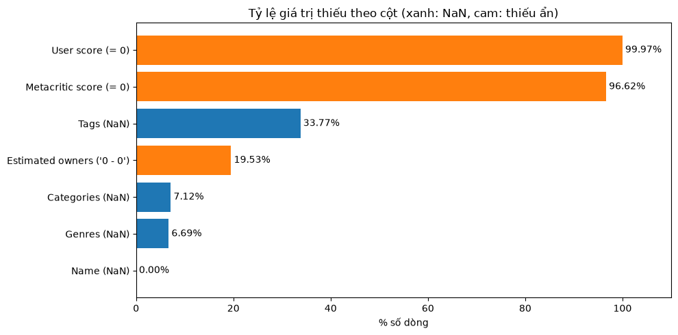

Nguồn: notebook 01_data_quality.ipynb, mục A3.

Cột User score bằng 0 ở 125.815 dòng (99,97%) và Metacritic score bằng 0 ở 121.597 dòng (96,62%). Vì điểm hợp lệ của hai thang đo nằm trong khoảng 1–100, giá trị 0 ở đây có nghĩa là trò chơi chưa có điểm. Kết quả này cũng cho thấy User score gần như không thể dùng để trả lời RQ2, và cần một thước đo đánh giá thay thế (mục 4.1).

Đối với Tags, giá trị thiếu không phân bố ngẫu nhiên: 99,1% trò chơi chưa có đánh giá nào bị thiếu Tags, trong khi tỷ lệ này là 0% ở các trò chơi đã có đánh giá. Điều này phù hợp với việc Tags do người chơi gắn.

### 3.2.3. Nhóm Estimated owners bằng "0 - 0"

Có 24.579 trò chơi (19,53%) có Estimated owners bằng "0 - 0", và không trò chơi nào trong số này có người chơi đồng thời, đánh giá hay thời gian chơi. Báo cáo giữa kỳ dựa vào đó để xem đây là trò chơi chưa có người dùng. Khi kiểm tra lại, nhóm thấy giả định này không đúng vì ba lý do.

- Có 372 trò chơi trong nhóm có lượt đề xuất, trong khi mọi chỉ số người chơi lại bằng 0. Nhóm này có cả những trò chơi rất lớn như EA SPORTS FC 26 (hơn 30.000 lượt đề xuất), Assassin's Creed Shadows (27.685 lượt) và Call of Duty: Warzone (9.607 lượt).
- Tỷ lệ "0 - 0" tăng rất nhanh theo năm phát hành: 0,9% ở năm 2020, 13,1% ở năm 2021, 41,2% ở năm 2025 và 91,0% ở năm 2026.
- Tỷ lệ này chênh lệch rất lớn giữa game miễn phí (62,7%) và game trả phí (7,9%).

Như vậy các số 0 trong nhóm này là thiếu dữ liệu chứ không phải giá trị thật. Do thiếu dữ liệu tập trung ở game miễn phí và game mới, việc xem chúng là số 0 đã làm game miễn phí có vẻ ít phổ biến hơn thực tế. Từ 2021 đến 2024, 73,5% game miễn phí bị thiếu dữ liệu này, vì vậy khi so sánh theo giá, nhóm chỉ xét các trò chơi phát hành đến năm 2020.

### 3.2.4. Dòng trùng lặp

Không có dòng nào trùng lặp hoàn toàn và không có mã id nào bị trùng. Khi so sánh mọi cột trừ id, nhóm phát hiện 8 dòng thừa giống hệt một dòng khác, thuộc 5 trò chơi. Đây là cùng một sản phẩm được đăng nhiều lần với các mã khác nhau. Bên cạnh đó, có những trò chơi trùng tên và ngày phát hành nhưng khác nhau về số liệu, được xem là những phiên bản khác nhau của cùng một sản phẩm.

### 3.2.5. Giá trị ngoài phạm vi và mâu thuẫn logic

Kiểm tra phạm vi cơ bản không phát hiện giá trị âm hay giá trị vượt ngưỡng hợp lệ nào. Các kiểm tra mâu thuẫn logic được tổng hợp ở Bảng 3.1.

Bảng 3.1. Kết quả kiểm tra mâu thuẫn logic

| Nội dung kiểm tra | Số dòng | Nhận định |
|---|---|---|
| Discount nằm ngoài khoảng 0–100 | 0 | Không có lỗi |
| Giá bằng 0 nhưng có mức giảm giá 1–99% | 35 | Trò chơi đã chuyển sang miễn phí nhưng còn lưu mức giảm giá cũ |
| Trò chơi có ngày phát hành sau ngày tham chiếu 03/11/2026 | 1 | Trò chơi Roten, chưa có người chơi và đánh giá thật |
| Số đánh giá hoặc Peak CCU lớn hơn số người sở hữu tối đa | 13 | Số người sở hữu chỉ là ước tính nên có thể sai (ví dụ Portal 2) |
| Thời gian chơi hai tuần lớn hơn tổng thời gian chơi | 855 | Hai chỉ số tính trên hai nhóm người chơi khác nhau, chưa đủ căn cứ để kết luận là lỗi |

Nguồn: notebook 01_data_quality.ipynb, mục A6.

### 3.2.6. Giá trị ngoại lai

Nhóm áp dụng phương pháp khoảng tứ phân vị (IQR) cho chín cột số. Phương pháp này đánh dấu một tỷ lệ lớn giá trị là ngoại lai, chẳng hạn 19.680 giá trị (15,64%) ở Peak CCU. Nguyên nhân thể hiện ở Hình 3.2: phần lớn các cột có tỷ lệ giá trị bằng 0 rất cao. Khi đó tứ phân vị thứ nhất và thứ ba đều bằng 0, nên mọi giá trị khác 0 đều bị xem là ngoại lai. Nói cách khác, IQR không phù hợp cho các cột có phân phối dồn về 0.

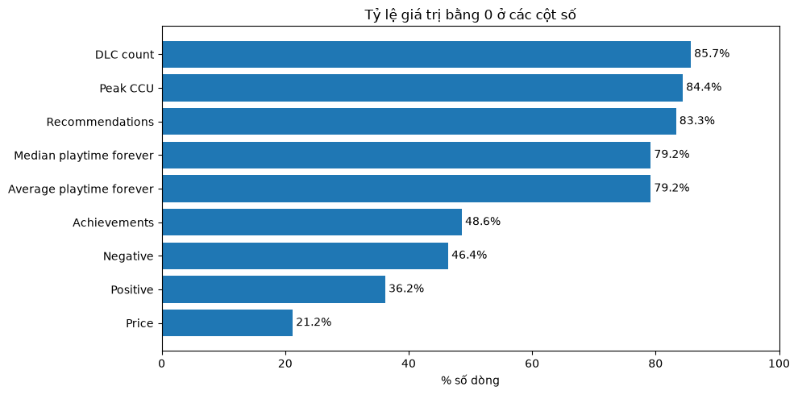

Nguồn: notebook 01_data_quality.ipynb, mục A6.

Xem xét các giá trị lớn nhất cho thấy phần lớn là giá trị thật: Counter-Strike 2 có Peak CCU là 1.013.936; Fantasy Grounds VTT có 3.703 DLC. Một số giá trị đáng nghi vấn, như thời gian chơi trung bình 3.429.544 phút (khoảng 6,5 năm) của Avem33, nhưng chưa đủ căn cứ để kết luận là sai. Vì vậy, nhóm giữ nguyên các giá trị ngoại lai và lựa chọn những phương pháp ít bị ảnh hưởng bởi ngoại lai, gồm trung vị, tỷ lệ phần trăm và tương quan Spearman.

## 3.3. Xử lý và làm sạch dữ liệu

Dựa trên kết quả kiểm tra, nhóm thực hiện các bước xử lý tóm tắt ở Bảng 3.2. Mỗi bước tương ứng với một dòng trong nhật ký làm sạch.

Bảng 3.2. Các bước làm sạch dữ liệu

| Vấn đề | Cách xử lý | Số dòng |
|---|---|---|
| Tên trò chơi có khoảng trắng thừa | Gộp các khoảng trắng thừa | 304 |
| Categories bị lặp nhãn | Bỏ nhãn lặp, giữ nguyên thứ tự | 96 |
| Release date dạng chuỗi | Chuyển sang kiểu ngày tháng | 125.855 |
| Name thiếu | Điền "Unknown", giữ dòng | 1 |
| Genres, Categories, Tags thiếu | Để trống, không suy đoán | 8.423; 8.966; 42.502 |
| Metacritic score bằng 0 | Đổi thành giá trị trống (NaN) | 121.597 |
| User score bằng 0 | Đổi thành giá trị trống (NaN) | 125.815 |
| Estimated owners bằng "0 - 0" | Giữ dòng trong tệp, bỏ khi phân tích độ phổ biến | 24.579 trước làm sạch |
| Dòng giống hệt nhau, chỉ khác id | Xóa dòng thừa, giữ id nhỏ nhất | 8 |
| Giá bằng 0 nhưng có giảm giá 1–99% | Đặt Discount bằng 0 | 35 |
| Trò chơi chưa phát hành | Xóa dòng | 1 |
| Số đánh giá hoặc Peak CCU lớn hơn số người sở hữu tối đa | Giữ nguyên, ghi nhận trong nhật ký | 13 |
| Thời gian chơi hai tuần lớn hơn tổng thời gian chơi | Giữ nguyên, ghi nhận trong nhật ký | 855 |
| Giá trị ngoại lai | Giữ nguyên | Không áp dụng |

Nguồn: notebook 01_data_quality.ipynb, mục B1–B6.

## 3.4. Kiểm tra dữ liệu sau làm sạch

Sau khi lưu, tệp games_cleaned.csv được đọc lại và so sánh với dữ liệu trước làm sạch (Bảng 3.3). Dữ liệu còn 125.846 trò chơi; chỉ 9 dòng bị xóa, gồm 8 dòng trùng lặp và 1 trò chơi chưa phát hành. Tổng số ô trống tăng từ 59.892 lên 307.276 là kết quả có chủ đích: các số 0 biểu thị "chưa có điểm" đã được chuyển thành giá trị trống.

Bảng 3.3. So sánh dữ liệu trước và sau làm sạch

| Chỉ tiêu | Trước | Sau |
|---|---|---|
| Số dòng | 125.855 | 125.846 |
| Số cột | 21 | 21 |
| Tổng số ô trống (NaN) | 59.892 | 307.276 |
| Dòng giống hệt nhau, chỉ khác id | 8 | 0 |
| Tên trò chơi có khoảng trắng thừa | 304 | 0 |
| Categories có nhãn lặp | 96 | 0 |
| Giá bằng 0 nhưng có giảm giá 1–99% | 35 | 0 |
| Trò chơi chưa phát hành | 1 | 0 |
| Metacritic score bằng 0 | 121.597 | 0 |
| User score bằng 0 | 125.815 | 0 |
| Estimated owners = "0 - 0" | 24.579 | 24.572 |
| Kiểu dữ liệu của Release date | Chuỗi | Ngày tháng |

Nguồn: notebook 01_data_quality.ipynb, mục B8.

Nhật ký chi tiết theo từng vấn đề, nguyên nhân, hành động và số dòng nằm ở [`reports/cleaning_log.csv`](cleaning_log.csv). Số `Estimated owners = "0 - 0"` trong nhật ký ghi nhận dữ liệu đầu vào của bước làm sạch; Bảng 3.3 cho thấy số còn lại sau khi loại dòng trùng và trò chơi chưa phát hành.

## 3.5. Các giả định trong quá trình làm sạch

Quá trình làm sạch dựa trên ba giả định:

- Ngày tham chiếu để xác định trò chơi chưa phát hành là 03/11/2026. Do bộ dữ liệu không ghi ngày thu thập, nhóm lấy ngày chạy phân tích làm mốc.
- Các trò chơi có Estimated owners bằng "0 - 0" là thiếu dữ liệu. Giả định này thay thế giả định ở báo cáo giữa kỳ.
- Giá trị 0 ở Metacritic score và User score được hiểu là chưa có điểm, dựa trên việc điểm hợp lệ của hai thang đo nằm trong khoảng 1–100.

Ngoài nhóm "0 - 0", một số trò chơi lớn cũng có số liệu không hợp lý, ví dụ Portal 2 có hơn 153.000 đánh giá tích cực nhưng owners là "0 - 20000" và Peak CCU bằng 0. Nhóm không có cách tách hết các trường hợp này nên giữ nguyên và ghi nhận là một hạn chế.

# CHƯƠNG 4. PHÂN TÍCH KHÁM PHÁ DỮ LIỆU

## 4.1. Phương pháp phân tích chung

Kết quả kiểm tra chất lượng cho thấy các chỉ số phổ biến và đánh giá có phân phối lệch rất mạnh, với tỷ lệ giá trị 0 cao. Vì vậy, nhóm sử dụng hệ số tương quan Spearman thay cho Pearson, và khi so sánh giữa các nhóm thì dùng trung vị và tỷ lệ phần trăm thay cho giá trị trung bình. Ngoài các cột có sẵn, nhóm xây dựng thêm một số chỉ số dẫn xuất (Bảng 4.1).

Bảng 4.1. Các chỉ số dẫn xuất dùng trong phân tích

| Chỉ số | Cách tính | Lý do |
|---|---|---|
| Owners_mid | Điểm giữa của khoảng Estimated owners | Quy đổi khoảng ước tính thành một giá trị số |
| Total reviews | Positive + Negative | Tổng số lượt đánh giá |
| Positive ratio | Positive / Total reviews × 100, chỉ tính cho trò chơi có từ 10 đánh giá trở lên | Thay thế User score; ngưỡng 10 đánh giá giúp tránh tỷ lệ không ổn định |
| Nhóm giá | Miễn phí (0 USD); Thấp (dưới 5 USD); Trung bình (5 đến dưới 15 USD); Cao (từ 15 USD) | Mốc 5 USD dựa trên việc khoảng 74% trò chơi có giá dưới 5 USD |
| Giai đoạn | Trước 2014; 2014-2017; 2018-2020; 2021-2023; 2024-2025 | So sánh theo thời gian phát hành (RQ4) |

Nguồn: notebook 02_eda.ipynb, mục 2.4 và 02b_eda_rq3_rq4.ipynb.

Do các vấn đề ở mục 3.2.3, mỗi phần phân tích dùng một phạm vi dữ liệu khác nhau (Bảng 4.2). Khi phân tích theo thể loại, cột Genres được tách theo dấu phẩy và mỗi trò chơi được tính vào từng thể loại mà nó thuộc về. Nhóm loại bỏ hai nhãn Free To Play và Early Access vì không phải thể loại nội dung.

Bảng 4.2. Phạm vi dữ liệu của từng phần phân tích

| Phần phân tích | Dữ liệu sử dụng | Số trò chơi |
|---|---|---|
| Giá bán, số lượng theo năm | Toàn bộ dữ liệu đã làm sạch | 125.846 |
| Độ phổ biến (RQ1) | Bỏ nhóm owners "0 - 0" | 101.274 |
| Đánh giá (RQ2) | Có từ 10 đánh giá | 56.662 |
| Thời gian chơi (RQ3) | Có thời gian chơi lớn hơn 0 | 26.173 |
| Theo thời gian (RQ4) | Bỏ nhóm owners "0 - 0" và năm 2026 | 100.974 |
| So sánh theo giá (RQ5) | Bỏ nhóm owners "0 - 0", chỉ xét đến năm 2020 | 39.367 |

Nguồn: nhóm tổng hợp.

## 4.2. Tổng quan dữ liệu sau làm sạch

### 4.2.1. Phân phối giá bán

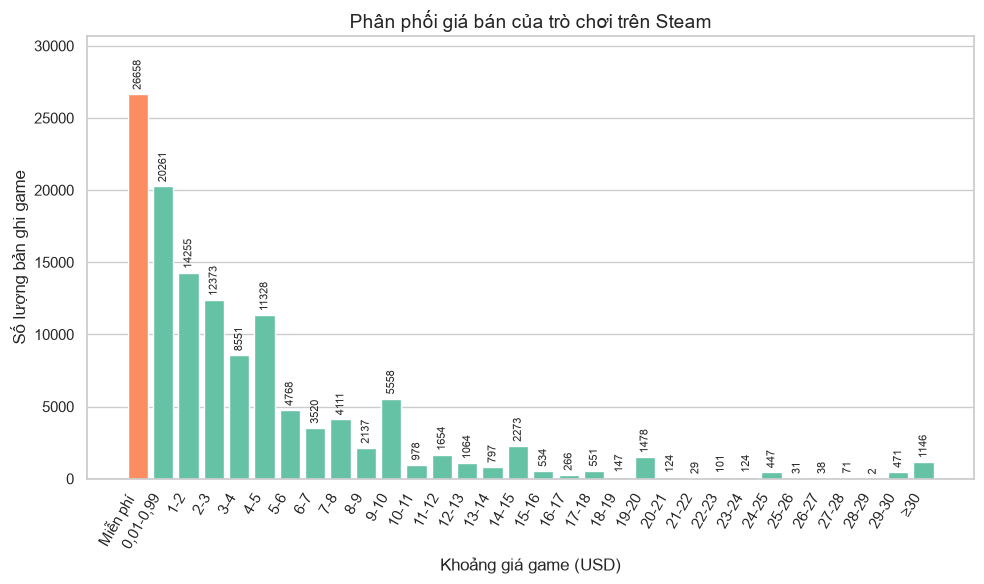

Nguồn: notebook 02_eda.ipynb, mục 2.3.2.

Hình 4.1 cho thấy phân phối giá lệch phải rất mạnh. Nhóm miễn phí là cột cao nhất với 26.658 trò chơi (21,2%), tiếp theo là khoảng 0,01–0,99 USD với 20.261 trò chơi. Khoảng 74% trò chơi có giá dưới 5 USD và khoảng 90% có giá dưới 10 USD, trong khi nhóm từ 30 USD trở lên chỉ có 1.146 trò chơi. Giá trung bình là 4,81 USD, cao hơn đáng kể so với trung vị 2,39 USD.

### 4.2.2. Tương quan giữa các biến số

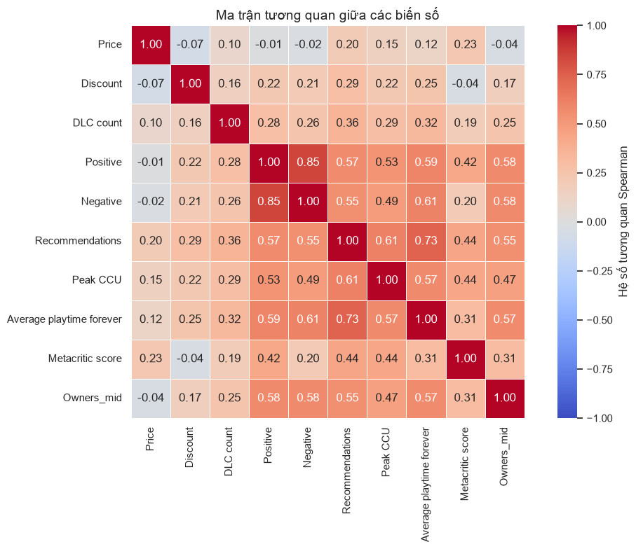

Nguồn: notebook 02_eda.ipynb, mục 2.3.3.

Hình 4.2 cho thấy số đánh giá tích cực và tiêu cực có hệ số 0,85; hai chỉ số này cùng có hệ số 0,58 với số người sở hữu. Số lượt đề xuất có tương quan 0,73 với thời gian chơi trung bình và 0,61 với Peak CCU. Giá bán chỉ tương quan yếu với các biến khác, với hệ số từ -0,07 đến 0,23.

Tương quan rất cao giữa số đánh giá tích cực và tiêu cực cho thấy số lượng đánh giá chủ yếu phản ánh quy mô của trò chơi chứ không phản ánh chất lượng. Vì vậy, để đo mức độ đánh giá, nhóm sử dụng tỷ lệ đánh giá tích cực thay vì số lượng đánh giá tuyệt đối.

## 4.3. RQ1 – Các yếu tố liên quan đến mức độ phổ biến

### 4.3.1. Số người sở hữu và số người chơi đồng thời

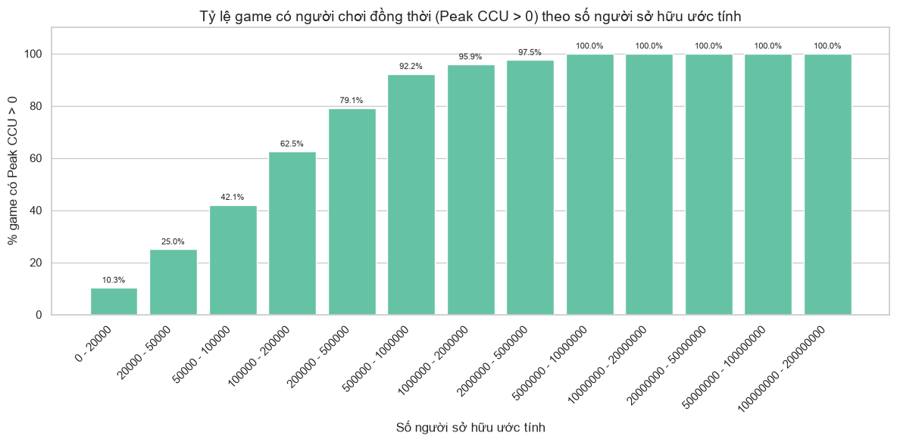

Nguồn: notebook 02_eda.ipynb, mục 2.4.1.

Hệ số tương quan Spearman giữa Owners_mid và Peak CCU là 0,47 trên các trò chơi có dữ liệu owners và 0,54 khi chỉ xét các trò chơi có Peak CCU lớn hơn 0, tức ở mức trung bình. Tuy vậy, khi xét theo nhóm (Hình 4.3), xu hướng lại rất rõ: tỷ lệ trò chơi có người chơi đồng thời tăng từ 10,3% ở nhóm 0–20.000 người sở hữu lên 62,5% ở nhóm 100.000–200.000, 92,2% ở nhóm 500.000–1.000.000 và đạt 100% từ nhóm 5 triệu người sở hữu trở lên.

Sự khác biệt này có thể giải thích bởi đặc điểm của dữ liệu: khoảng 81% trò chơi có Peak CCU bằng 0, Estimated owners chỉ là các khoảng rộng, và Peak CCU là đỉnh trong một ngày trong khi số người sở hữu là giá trị tích lũy. Trong các chỉ số phổ biến, số người sở hữu liên hệ chặt chẽ nhất với tổng số đánh giá (0,58), tiếp đến là số lượt đề xuất (0,55). Câu trả lời cho câu hỏi phụ là: số người sở hữu và Peak CCU có liên hệ cùng chiều rõ ràng, nhưng ở mức trung bình chứ không phải tương quan mạnh.

### 4.3.2. Lượt đề xuất và số người chơi đồng thời

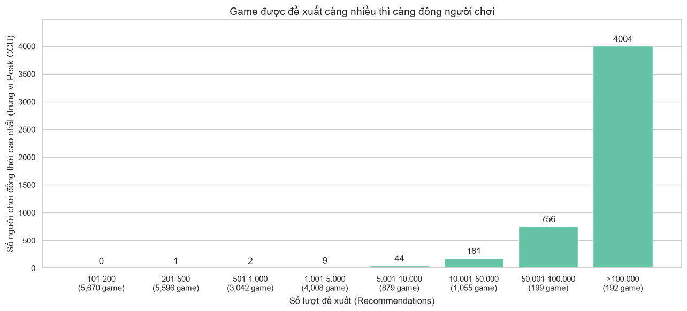

Nguồn: notebook 02_eda.ipynb, mục 2.3.4.

Peak CCU trung vị tăng dần theo số lượt đề xuất (Hình 4.4): từ 0–2 ở các nhóm dưới 1.000 lượt, lên 9 ở nhóm 1.001–5.000, 44 ở nhóm 5.001–10.000, 181 ở nhóm 10.001–50.000, 756 ở nhóm 50.001–100.000 và 4.004 ở nhóm trên 100.000 lượt. Các nhóm cuối chỉ gồm số ít trò chơi: nhóm trên 100.000 lượt có 192 trò chơi, trong khi hai nhóm dưới 500 lượt có 11.266 trò chơi, khoảng 55% số trò chơi có lượt đề xuất. Kết quả cho thấy mức độ phổ biến tập trung vào một nhóm nhỏ trò chơi rất nổi tiếng.

### 4.3.3. Mức độ phổ biến theo thể loại

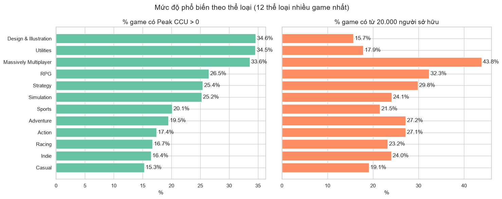

Nguồn: notebook 02_eda.ipynb, mục 2.4.2.

Do Peak CCU trung vị của hầu hết thể loại đều bằng 0, nhóm so sánh tỷ lệ trò chơi phổ biến trong từng thể loại (Hình 4.5). Massively Multiplayer, RPG, Strategy và Simulation có tỷ lệ trò chơi có người chơi đồng thời cao nhất, từ 25,2% đến 33,6%. Massively Multiplayer cũng dẫn đầu về tỷ lệ trò chơi có từ 20.000 người sở hữu (43,8%), tiếp theo là RPG (32,3%) và Strategy (29,8%). Ở chiều ngược lại, Casual, Indie và Racing có tỷ lệ thấp nhất, từ 15,3% đến 16,7%.

Casual và Indie lại là hai thể loại có nhiều trò chơi nhất (43.709 và 71.914 trò chơi). Điều này gợi ý rằng ở các thể loại có mức độ cạnh tranh cao, phần lớn trò chơi chỉ có rất ít người chơi. Design & Illustration và Utilities có tỷ lệ cao nhưng đây là phần mềm chứ không phải trò chơi, nên nhóm không dùng để kết luận.

Tổng hợp lại, đối với RQ1, các chỉ số phổ biến liên hệ cùng chiều với nhau, và mức độ phổ biến có liên hệ với thể loại: các trò chơi nhiều người chơi, nhập vai và chiến thuật có tỷ lệ phổ biến cao hơn, còn Casual và Indie có tỷ lệ thấp nhất.

## 4.4. RQ2 – Các yếu tố liên quan đến mức độ đánh giá tích cực

Vì User score chỉ có ở 40 trò chơi, nhóm sử dụng Positive ratio làm thước đo đánh giá. Nhóm owners "0 - 0" không có đánh giá nào, nên kết quả của phần này không bị ảnh hưởng bởi thay đổi ở mục 1.6.

### 4.4.1. Phân phối tỷ lệ đánh giá tích cực

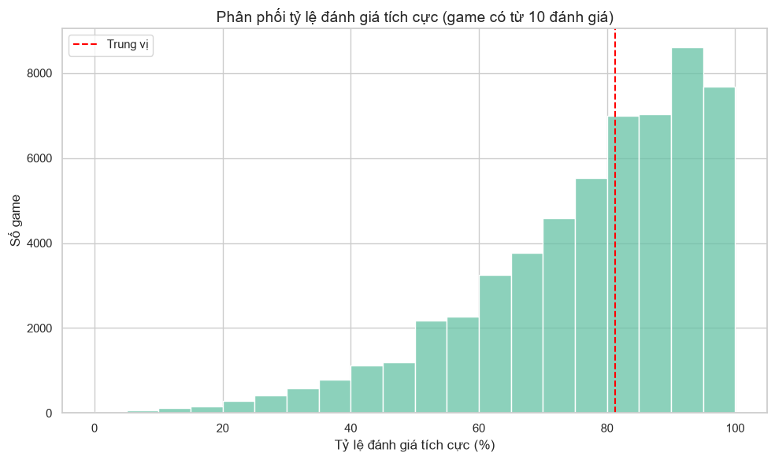

Nguồn: notebook 02_eda.ipynb, mục 2.4.3.

Trong 56.662 trò chơi có từ 10 đánh giá, tỷ lệ đánh giá tích cực trung bình là 77,2% và trung vị là 81,2%. Phân phối lệch trái (Hình 4.6): 25% trò chơi có trên 91,0%, trong khi chỉ 10% có dưới 51,9%. Như vậy, phần lớn trò chơi được người chơi đánh giá tốt, nên khi so sánh giữa các nhóm, những chênh lệch vài điểm phần trăm đã có ý nghĩa nhất định.

### 4.4.2. Đánh giá của người chơi so với điểm Metacritic

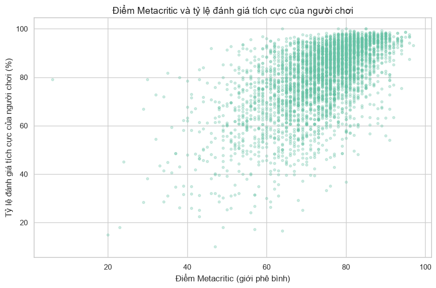

Nguồn: notebook 02_eda.ipynb, mục 2.4.4.

Chỉ có 4.145 trò chơi vừa có điểm Metacritic vừa có từ 10 đánh giá. Hệ số tương quan Spearman giữa hai chỉ số là 0,58, cho thấy trò chơi được giới phê bình chấm cao thường cũng được người chơi đánh giá tốt. Tuy nhiên, Hình 4.7 cũng cho thấy nhiều trò chơi có điểm Metacritic khá nhưng tỷ lệ tích cực thấp và ngược lại. Các trò chơi có điểm Metacritic thường là trò chơi lớn, nên kết quả không đại diện cho toàn bộ Steam. Câu trả lời cho câu hỏi phụ là: đánh giá của người chơi và giới phê bình tương đồng ở mức khá, cùng chiều nhưng không trùng khớp.

### 4.4.3. Tỷ lệ đánh giá tích cực theo thể loại

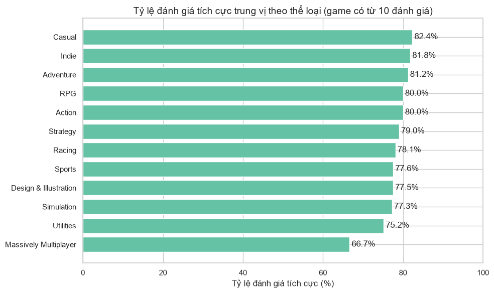

Nguồn: notebook 02_eda.ipynb, mục 2.4.5.

Hầu hết thể loại có tỷ lệ tích cực trung vị gần nhau, từ 75,2% đến 82,4% (Hình 4.8), trong đó Casual (82,4%), Indie (81,8%) và Adventure (81,2%) cao nhất. Massively Multiplayer là ngoại lệ rõ rệt với 66,7%. Kết hợp với RQ1, Massively Multiplayer thuộc nhóm phổ biến nhất nhưng có tỷ lệ đánh giá tích cực thấp nhất, trong khi Casual và Indie có tỷ lệ phổ biến thấp nhưng được đánh giá tốt.

### 4.4.4. Tỷ lệ đánh giá tích cực theo tính năng

Bảng 4.3. Tỷ lệ đánh giá tích cực trung vị giữa trò chơi có và không có tính năng

| Tính năng | Số trò chơi có tính năng | Trung vị khi có (%) | Trung vị khi không có (%) | Chênh lệch (điểm %) |
|---|---|---|---|---|
| Single-player | 53.702 | 81,8 | 73,5 | +8,2 |
| Có Achievements | 36.606 | 83,3 | 76,5 | +6,8 |
| Steam Cloud | 19.486 | 85,3 | 78,6 | +6,7 |
| Full controller support | 15.528 | 85,5 | 79,4 | +6,1 |
| Co-op | 6.591 | 79,7 | 81,6 | −1,9 |
| Multi-player | 11.800 | 78,6 | 82,0 | −3,4 |
| Online PvP | 5.106 | 76,5 | 81,8 | −5,3 |

Ghi chú: chỉ tính các trò chơi có từ 10 đánh giá. Nguồn: notebook 02_eda.ipynb, mục 2.4.6.

Trò chơi có Achievements có tỷ lệ tích cực trung vị cao hơn 6,8 điểm phần trăm so với trò chơi không có. Tuy nhiên, tương quan Spearman giữa số lượng Achievements và tỷ lệ tích cực chỉ là 0,16. Steam Cloud (+6,7) và Full controller support (+6,1) cũng đi kèm đánh giá cao hơn. Single-player có chênh lệch lớn nhất (+8,2), nhưng nhóm không có nhãn này chỉ gồm 2.960 trò chơi. Multi-player (−3,4) và Online PvP (−5,3) đi kèm tỷ lệ tích cực thấp hơn, nhưng kết quả hồi quy ở mục 6.2 cho thấy mức chênh lệch này không còn ý nghĩa khi đã tính đến thể loại.

Như vậy, đối với RQ2, mức độ đánh giá tích cực có liên hệ với thể loại và các tính năng thể hiện sự hoàn thiện của trò chơi. Các chênh lệch chỉ khoảng 2–8 điểm phần trăm và chỉ phản ánh mối liên hệ.

## 4.5. RQ3 – Các yếu tố liên quan đến thời gian chơi

Thời gian chơi được đo bằng Median playtime forever, đơn vị phút. Chỉ 26.173 trò chơi (20,8%) có giá trị lớn hơn 0, nên kết quả của RQ3 nói về nhóm trò chơi này. Trung vị là 204 phút, tức khoảng 3,4 giờ, và một nửa số trò chơi nằm trong khoảng 80 đến 383 phút.

### 4.5.1. Thời gian chơi theo thể loại

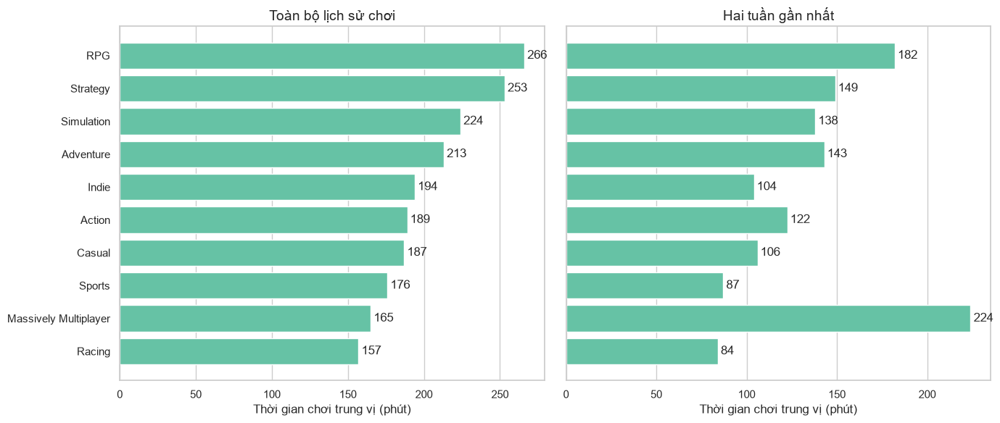

Nguồn: notebook 02b_eda_rq3_rq4.ipynb, mục 2b.3.

Trên toàn bộ lịch sử chơi (Hình 4.9), RPG cao nhất (266 phút), tiếp theo là Strategy (253 phút) và Simulation (224 phút); Racing thấp nhất (157 phút). Trong hai tuần gần nhất, Massively Multiplayer cao nhất (224 phút) dù chỉ xếp thứ 9 trên toàn bộ lịch sử, còn RPG và Strategy vẫn đứng thứ 2 và 3. Tương quan thứ hạng giữa hai cột là 0,52. Câu trả lời cho câu hỏi phụ là: RPG có thời gian chơi trung vị cao nhất, và xu hướng giữa hai cột chỉ giống nhau một phần. Cột hai tuần chỉ có 3.948 trò chơi và chỉ gồm trò chơi vẫn còn người chơi, nên hai cột không so sánh trên cùng một nhóm.

### 4.5.2. Thời gian chơi theo giá và tính năng

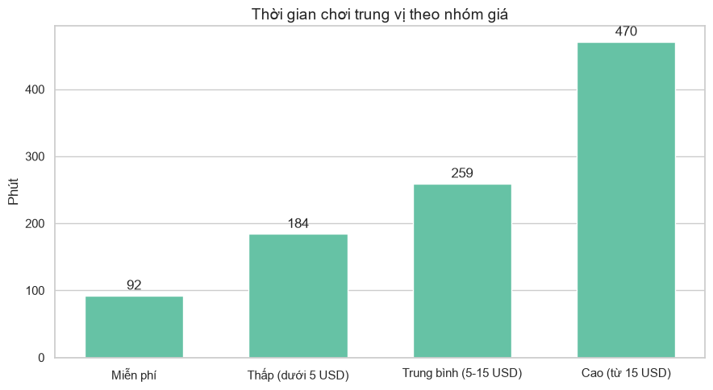

Nguồn: notebook 02b_eda_rq3_rq4.ipynb, mục 2b.4.

Giá càng cao thì thời gian chơi càng dài (Hình 4.10): 92 phút ở nhóm miễn phí, 184 phút ở nhóm thấp, 259 phút ở nhóm trung bình và 470,5 phút ở nhóm cao. Steam Cloud có chênh lệch lớn nhất giữa trò chơi có và không có tính năng (+82 phút). Multi-player và Online PvP gần như không khác biệt (−6 và −3 phút). Thời gian chơi liên hệ cùng chiều với Peak CCU (0,346), giá (0,283), số đánh giá (0,251) và Achievements (0,239), đều ở mức yếu đến trung bình.

Tổng hợp lại, đối với RQ3, thời gian chơi có liên hệ với thể loại và giá. Game nhập vai, chiến thuật và game giá cao được chơi lâu hơn.

## 4.6. RQ4 – Mức độ phổ biến và đánh giá theo thời gian phát hành

Phần này bỏ nhóm owners "0 - 0" và bỏ năm 2026, vì dữ liệu năm này gần như dừng ở tháng 3 và 91,0% trò chơi bị thiếu dữ liệu owners.

### 4.6.1. Xu hướng theo năm

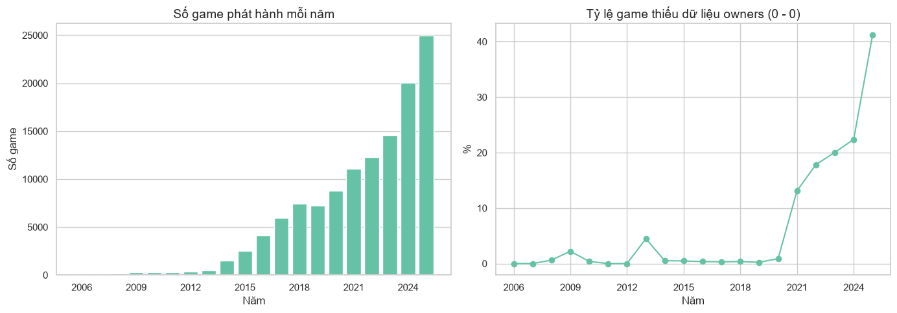

Nguồn: notebook 02b_eda_rq3_rq4.ipynb, mục 2b.6.

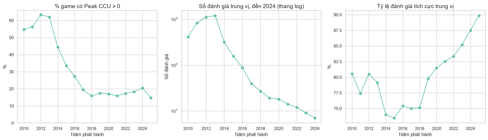

Nguồn: notebook 02b_eda_rq3_rq4.ipynb, mục 2b.7.

Số trò chơi tăng rất nhanh, từ 1.523 trò chơi năm 2014 lên 24.973 trò chơi năm 2025 (Hình 4.11). Tỷ lệ trò chơi có Peak CCU > 0 giảm từ khoảng 62% ở năm 2012-2013 xuống 15,9% ở năm 2018, sau đó ổn định quanh 16-20% đến năm 2024 (Hình 4.12). Số đánh giá trung vị giảm từ 1.197 (2013) xuống 7 (2024), một phần vì trò chơi cũ có nhiều thời gian tích lũy hơn. Tỷ lệ tích cực thấp nhất ở năm 2015 (73,5%) rồi tăng dần lên 89,8% ở năm 2025. Tuy nhiên tỷ lệ trò chơi đủ 10 đánh giá cũng giảm từ 96,2% xuống 21,5%, tức năm càng mới thì càng chỉ còn những trò chơi khá nổi mới được tính.

### 4.6.2. So sánh giữa các giai đoạn

Bảng 4.4. Mức độ phổ biến và đánh giá theo giai đoạn phát hành

| Giai đoạn | Số trò chơi | Tỷ lệ có Peak CCU > 0 (%) | Số đánh giá trung vị | Tỷ lệ tích cực trung vị (%) | Tỷ lệ tích cực, từ 100 đánh giá (%) |
|---|---|---|---|---|---|
| Trước 2014 | 1.935 | 62,3 | 810 | 80,8 | 81,9 |
| 2014-2017 | 14.047 | 26,9 | 84 | 75,0 | 78,6 |
| 2018-2020 | 23.385 | 16,8 | 21 | 78,9 | 83,4 |
| 2021-2023 | 31.379 | 17,2 | 11 | 83,6 | 84,7 |
| 2024-2025 | 30.228 | 17,7 | 2 | 88,2 | 86,5 |

Nguồn: notebook 02b_eda_rq3_rq4.ipynb, mục 2b.8.

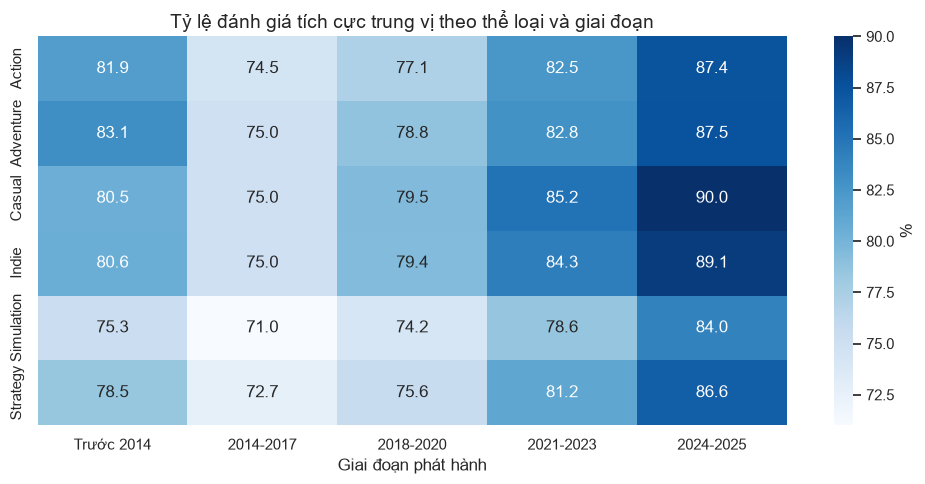

Nguồn: notebook 02b_eda_rq3_rq4.ipynb, mục 2b.8.

Giai đoạn trước 2014 có 62,3% trò chơi có người chơi đồng thời, cao hơn hẳn các giai đoạn sau. Vì Peak CCU chỉ đo trong một ngày, con số này cho thấy nhiều trò chơi cũ sau hơn 10 năm vẫn còn người chơi. Từ 2018 trở đi tỷ lệ gần như không đổi. Tỷ lệ tích cực thấp nhất ở 2014-2017 và cao nhất ở 2024-2025, và xu hướng này giống nhau ở cả 6 thể loại lớn (Hình 4.13). Khi chỉ xét trò chơi có từ 100 đánh giá, xu hướng tăng vẫn còn nhưng nhỏ hơn: từ 78,6% lên 86,5%.

Tổng hợp lại, đối với RQ4, trò chơi phát hành sớm có tỷ lệ còn người chơi và số đánh giá cao hơn rõ rệt, còn từ 2018 tỷ lệ này gần như không đổi. Tỷ lệ tích cực giảm đến 2014-2017 rồi tăng lại. Tuy nhiên trò chơi cũ có nhiều thời gian tích lũy hơn, trò chơi cũ còn tồn tại thường là trò chơi tốt, và dữ liệu các năm gần đây thiếu nhiều, nên không thể kết luận trò chơi ngày nay thật sự được yêu thích hơn hay kém phổ biến hơn.

## 4.7. RQ5 – Mối liên hệ giữa giá bán với mức độ phổ biến và đánh giá

### 4.7.1. Giá bán giữa các thể loại

Bảng 4.5. Giá bán theo thể loại

| Thể loại | Số trò chơi | Giá trung vị của trò chơi trả phí (USD) |
|---|---|---|
| Casual | 51.670 | 2,99 |
| Indie | 82.883 | 2,99 |
| Racing | 4.169 | 3,49 |
| Action | 47.343 | 3,74 |
| Adventure | 46.291 | 3,99 |
| Strategy | 23.057 | 3,99 |
| Sports | 4.970 | 3,99 |
| Simulation | 24.909 | 3,99 |
| Massively Multiplayer | 2.595 | 4,99 |
| RPG | 21.576 | 4,99 |

Nguồn: notebook 02_eda.ipynb, mục 2.3.6.

Giá trung vị của trò chơi trả phí chênh lệch không nhiều giữa các thể loại, phần lớn nằm trong khoảng 2,99–4,99 USD. Bảng 4.5 cho thấy giá và thể loại có liên quan với nhau, vì vậy khi phân tích giá cần kiểm tra lại trong từng thể loại (mục 4.7.4).

### 4.7.2. Mức độ phổ biến và đánh giá theo nhóm giá

Phần này chỉ xét các trò chơi phát hành đến năm 2020 và có dữ liệu owners, với lý do đã nêu ở mục 3.2.3.

Bảng 4.6. Mức độ phổ biến và đánh giá theo nhóm giá (trò chơi đến năm 2020)

| Nhóm giá | Số trò chơi | Tỷ lệ có Peak CCU > 0 (%) | Peak CCU trung bình | Tỷ lệ có từ 20.000 người sở hữu (%) | Tỷ lệ tích cực trung vị (%) |
|---|---|---|---|---|---|
| Miễn phí | 5.831 | 25,5 | 454,4 | 50,3 | 77,0 |
| Thấp (dưới 5 USD) | 24.400 | 19,9 | 27,5 | 37,0 | 76,5 |
| Trung bình (5–15 USD) | 7.683 | 26,5 | 85,7 | 33,6 | 80,0 |
| Cao (từ 15 USD) | 1.453 | 36,4 | 264,5 | 35,1 | 75,7 |

Ghi chú: tỷ lệ tích cực chỉ tính cho trò chơi có từ 10 đánh giá. Nguồn: notebook 02_eda.ipynb, mục 2.4.7.

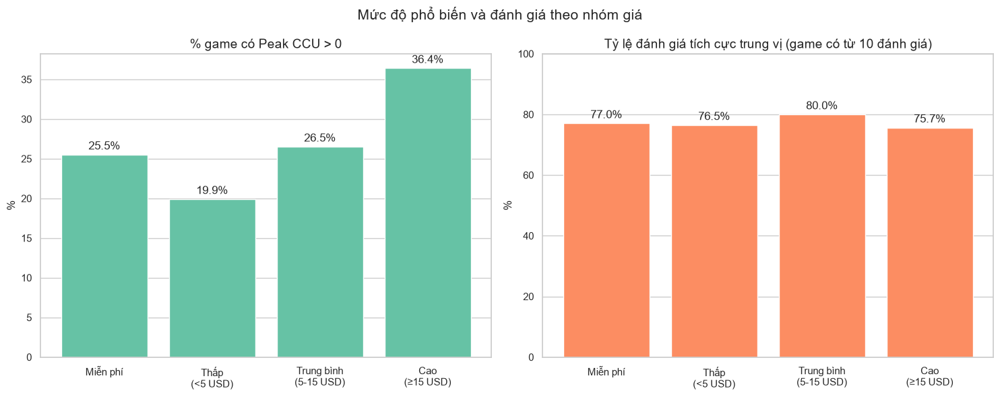

Nguồn: notebook 02_eda.ipynb, mục 2.4.7.

Trong các trò chơi trả phí, giá cao hơn đi kèm tỷ lệ có người chơi đồng thời cao hơn (Hình 4.14): 19,9%, 26,5% và 36,4%. Game miễn phí có 25,5%, cao hơn nhóm giá thấp và gần bằng nhóm trung bình, nên tỷ lệ này không tăng đều theo giá. Tỷ lệ trò chơi có từ 20.000 người sở hữu không tăng theo giá: game miễn phí cao nhất (50,3%), còn ba nhóm trả phí gần bằng nhau. Tỷ lệ tích cực cao nhất ở nhóm giá trung bình (80,0%), ba nhóm còn lại từ 75,7% đến 77,0%. Tương quan Spearman giữa giá và tỷ lệ tích cực chỉ là 0,12.

### 4.7.3. Game miễn phí và game trả phí

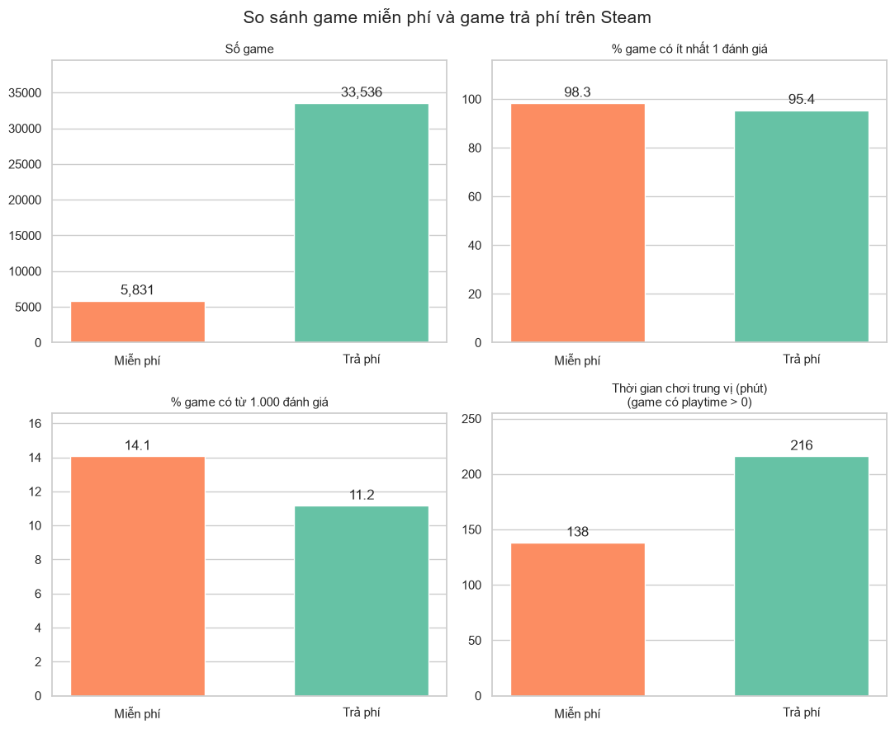

Nguồn: notebook 02_eda.ipynb, mục 2.3.5.

Trong phạm vi này có 33.536 trò chơi trả phí và 5.831 trò chơi miễn phí (Hình 4.15). Gần như tất cả đều đã có đánh giá (95,4% và 98,3%). Game miễn phí có tỷ lệ đạt từ 1.000 đánh giá cao hơn một chút (14,1% so với 11,2%), còn game trả phí được chơi lâu hơn (216 phút so với 138 phút).

Đối với câu hỏi phụ, Peak CCU trung bình của game miễn phí (454,4) cao hơn nhiều so với game trả phí (51,1), trong khi trung vị của cả hai nhóm đều bằng 0. Mức trung bình cao đến từ một số ít trò chơi rất lớn: Counter-Strike 2, Dota 2 và PUBG: BATTLEGROUNDS chiếm 73,7% tổng Peak CCU của nhóm miễn phí. Khi bỏ 10 trò chơi lớn nhất, Peak CCU trung bình chỉ còn 49,5, gần bằng game trả phí. Tỷ lệ có người chơi đồng thời của hai nhóm cũng gần nhau (25,5% và 22,1%). Câu trả lời cho câu hỏi phụ là: một trò chơi miễn phí điển hình có lượng người chơi đồng thời gần bằng trò chơi trả phí; mức trung bình cao chỉ phản ánh vài trò chơi rất lớn.

### 4.7.4. Giá và đánh giá trong từng thể loại

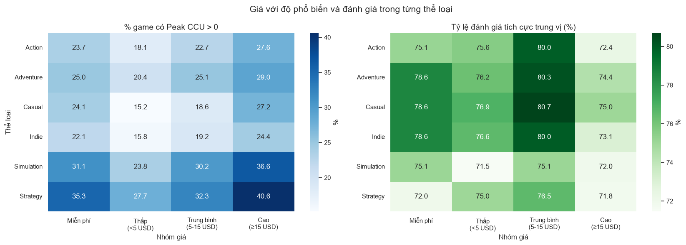

Nguồn: notebook 02_eda.ipynb, mục 2.4.8.

Ở cả sáu thể loại (Hình 4.16), tỷ lệ có người chơi đồng thời đều tăng từ nhóm giá thấp lên nhóm giá cao, chẳng hạn Strategy từ 27,7% lên 40,6%, Action từ 18,1% lên 27,6%. Game miễn phí đều cao hơn nhóm giá thấp. Tỷ lệ tích cực cao nhất ở nhóm giá trung bình, riêng Simulation thì nhóm miễn phí bằng nhóm trung bình (75,1%). Như vậy các xu hướng về giá không phải do khác biệt giữa các thể loại.

Tổng hợp lại, đối với RQ5, trong các trò chơi trả phí, giá cao hơn đi kèm tỷ lệ có người chơi đồng thời cao hơn, nhưng không đi kèm tỷ lệ có nhiều người sở hữu cao hơn. Game miễn phí không thua game trả phí về độ phổ biến. Giá liên hệ rất yếu với mức độ đánh giá. Trò chơi giá cao thường do các công ty lớn phát triển với ngân sách quảng bá lớn hơn, nên đây không phải tác động của giá. Ngoài ra, giá trong dữ liệu là giá hiện tại, không nhất thiết là giá tại thời điểm người chơi mua trò chơi.

## 4.8. Insights tổng hợp

| Insight | Bằng chứng trong dữ liệu | Cách diễn giải |
|---|---|---|
| Phổ biến và được đánh giá tốt là hai khía cạnh khác nhau. | Massively Multiplayer có tỷ lệ game với Peak CCU > 0 cao nhất (33,6%) nhưng tỷ lệ tích cực trung vị chỉ 66,7%, thấp hơn trung vị chung 81,2%. | Không nên dùng lượt chơi hoặc độ phổ biến làm đại diện cho mức hài lòng. |
| Giá liên hệ với khả năng có người chơi hơn là số chủ sở hữu hay đánh giá. | Trong game trả phí đến năm 2020, tỷ lệ Peak CCU > 0 tăng từ 19,9% ở nhóm giá thấp lên 36,4% ở nhóm giá cao; tỷ lệ có từ 20.000 owners không tăng tương ứng, còn Spearman giữa giá và tỷ lệ tích cực là 0,12. | Quan hệ này không chứng minh tăng giá sẽ làm game phổ biến hơn; thể loại, quy mô nhà phát hành và quảng bá cũng có thể góp phần. |
| So sánh theo năm bị ảnh hưởng bởi thời gian tích lũy và độ phủ đánh giá. | Trung vị số đánh giá giảm từ 810 ở game trước 2014 xuống 2 ở game 2024–2025; tỷ lệ Peak CCU > 0 cũng giảm từ 62,3% xuống 17,7%. | Không thể đọc xu hướng theo năm như thay đổi thuần túy về chất lượng; cần theo dõi cùng khoảng thời gian sau phát hành. |
| Thiếu owners tập trung ở game miễn phí và game mới, làm sai kết luận nếu coi là số 0 thật. | Nhóm `0 - 0` chiếm 62,7% game miễn phí và 7,9% game trả phí; tỷ lệ này tăng lên 41,2% ở game phát hành năm 2025. | Loại nhóm thiếu khỏi phân tích độ phổ biến và giới hạn so sánh theo giá đến năm 2020 là cần thiết. |
| Mô hình dự đoán hoạt động khác nhau giữa các nhóm. | Recall của Random Forest là 0,615 với game Indie và 0,806 với game không có Indie. | Không nên dùng mô hình để sàng lọc từng game nếu chưa xử lý chênh lệch hiệu quả theo nhóm. |

Các insight này là mối liên hệ trong dữ liệu quan sát, không phải quan hệ nhân quả.

# CHƯƠNG 5. THỐNG KÊ SUY LUẬN

Chương này kiểm tra xem các khác biệt ở chương 4 có phải do ngẫu nhiên không. Dữ liệu đầu vào là tệp games_features.csv gồm 100.025 trò chơi (mục 6.1). Các số liệu có thể lệch một chút so với chương 4 vì tệp này bỏ thêm năm 2026 và các trò chơi thiếu Genres hoặc Categories.

## 5.1. Thống kê mô tả và xác suất

Giá, Peak CCU, số đánh giá và thời gian chơi đều lệch rất mạnh, với độ lệch (skew) từ 28 đến 240. Ví dụ Peak CCU có trung bình 66,59 nhưng trung vị bằng 0. Đây là lý do nhóm dùng trung vị và các kiểm định phi tham số.

Nhóm ước lượng xác suất bằng tần suất trong dữ liệu. Gọi A là sự kiện trò chơi có Peak CCU > 0 và B là sự kiện trò chơi có Steam Cloud. Ta có P(A) = 0,194 và P(B) = 0,28. Nếu A và B độc lập thì P(A và B) phải bằng P(A) × P(B) = 0,054, nhưng thực tế là 0,099, nên hai sự kiện không độc lập. Xác suất có điều kiện P(A | B) = 0,354, so với P(A | không B) = 0,132. Theo định lý Bayes, P(B | A) = 0,51, đúng bằng kết quả đếm trực tiếp.

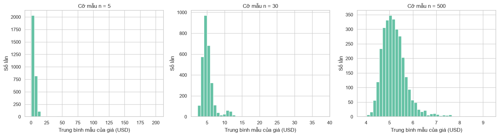

Nguồn: notebook 06_statistical_inference.ipynb, mục 6.3.

Hình 5.1 minh họa định lý giới hạn trung tâm. Giá lệch rất mạnh, nhưng phân phối của trung bình mẫu gần chuẩn dần khi cỡ mẫu tăng, độ lệch giảm từ 17,6 (n = 5) xuống 1,34 (n = 500). Đây là cơ sở của khoảng tin cậy ở mục sau.

## 5.2. Khoảng tin cậy

Tỷ lệ trò chơi có Peak CCU > 0 là 19,40%, khoảng tin cậy 95% là 19,15% đến 19,64%. Khoảng này rất hẹp vì dữ liệu lớn. Với trung vị không có công thức đơn giản nên nhóm dùng bootstrap với 1.000 lần lấy mẫu lại: chênh lệch trung vị Positive ratio giữa trò chơi có và không có Achievements là 6,75 điểm, khoảng tin cậy 6,41 đến 7,14. Khoảng này không chứa 0 nên chênh lệch khó là do ngẫu nhiên.

## 5.3. Kiểm định giả thuyết

Giả thuyết H0 của mỗi kiểm định là không có liên hệ hoặc không có khác biệt, mức ý nghĩa 0,05. Vì dữ liệu không theo phân phối chuẩn, nhóm dùng các kiểm định phi tham số của thư viện SciPy [3]. Có 11 kiểm định nên nhóm dùng hiệu chỉnh Bonferroni, ngưỡng còn 0,00455. Do cỡ mẫu rất lớn, nhóm báo cáo thêm cỡ ảnh hưởng.

Bảng 5.1. Kết quả kiểm định cho các câu hỏi nghiên cứu

| RQ | Nội dung | Kiểm định | Số trò chơi | p | Cỡ ảnh hưởng |
|---|---|---|---|---|---|
| RQ1 | Owners và Peak CCU | Spearman | 100.025 | < 0,001 | rho = 0,469 |
| RQ1 | MMO và có Peak CCU > 0 | Chi bình phương | 100.025 | < 0,001 | V = 0,05 |
| RQ2 | Metacritic và tỷ lệ tích cực | Spearman | 4.137 | < 0,001 | rho = 0,583 |
| RQ2 | Tỷ lệ tích cực: MMO và game khác | Mann-Whitney U | 56.166 | < 0,001 | r = −0,42 |
| RQ3 | Thời gian chơi theo nhóm giá | Kruskal-Wallis | 25.912 | < 0,001 | eta2 = 0,08 |
| RQ3 | Thời gian chơi: RPG và game khác | Mann-Whitney U | 25.912 | < 0,001 | r = 0,206 |
| RQ4 | Tỷ lệ tích cực theo giai đoạn | Kruskal-Wallis | 56.166 | < 0,001 | eta2 = 0,072 |
| RQ4 | Giai đoạn và có Peak CCU > 0 | Chi bình phương | 100.025 | < 0,001 | V = 0,175 |
| RQ5 | Nhóm giá và có Peak CCU > 0 (đến 2020) | Chi bình phương | 38.886 | < 0,001 | V = 0,095 |
| RQ5 | Peak CCU: miễn phí và trả phí (đến 2020) | Mann-Whitney U | 38.886 | < 0,001 | r = 0,035 |
| RQ5 | Giá và tỷ lệ tích cực | Spearman | 56.166 | < 0,001 | rho = 0,12 |

Nguồn: notebook 06_statistical_inference.ipynb, mục 6.5.

Cả 11 kiểm định đều bác bỏ H0. Điều này không bất ngờ vì cỡ mẫu rất lớn, nên cần xem cỡ ảnh hưởng. Các liên hệ rõ nhất là Metacritic với tỷ lệ tích cực, owners với Peak CCU, và MMO có tỷ lệ tích cực thấp hơn. Peak CCU của game miễn phí và trả phí gần như không khác nhau (r = 0,035) dù p rất nhỏ. Đây là ví dụ cho thấy có ý nghĩa thống kê không có nghĩa là khác biệt lớn.

## 5.4. Phân tích kiểu A/B

A/B testing thật cần chia ngẫu nhiên đối tượng vào hai nhóm. Dữ liệu của dự án là dữ liệu quan sát nên không làm được đúng nghĩa. Nhóm vẫn làm theo các bước của A/B test để so sánh hai nhóm, nhưng kết quả chỉ là mối liên hệ. Nhóm A là trò chơi không có Achievements, nhóm B là trò chơi có Achievements, chỉ số so sánh là tỷ lệ trò chơi được đánh giá tốt (Positive ratio từ 80% trở lên).

Nhóm A có 19.633 trò chơi với tỷ lệ tốt 44,2%, nhóm B có 36.533 trò chơi với tỷ lệ tốt 58,6%. Chênh lệch là 14,5 điểm, khoảng tin cậy 13,6 đến 15,3, kiểm định hai tỷ lệ cho z = 32,83 và p < 0,001.

Hai nhóm không được chia ngẫu nhiên, nên có thể khác nhau ở những yếu tố khác. Khi so sánh lại, chênh lệch vẫn còn trong từng giai đoạn (6,7 đến 14,9 điểm) và từng nhóm giá (6,8 đến 16,4 điểm). Tuy vậy vẫn không thể nói thêm Achievements làm trò chơi được đánh giá tốt hơn, vì nhà phát triển làm Achievements thường đầu tư cho trò chơi nhiều hơn.

Nếu làm A/B test thật, cần tính trước cỡ mẫu. Ví dụ để phát hiện tỷ lệ chuyển đổi tăng từ 5% lên 6% (con số giả định để minh họa), với mức ý nghĩa 0,05 và power 0,8, cần 8.143 người mỗi nhóm.

# CHƯƠNG 6. XÂY DỰNG VÀ ĐÁNH GIÁ MÔ HÌNH

## 6.1. Chuẩn bị dữ liệu

Từ 125.846 trò chơi, nhóm bỏ nhóm owners "0 - 0", năm 2026 và các trò chơi thiếu Genres hoặc Categories, còn 100.025 trò chơi (79,5%).

Về biến đổi dữ liệu, các cột giá, số đánh giá, số thành tựu và thời gian chơi được lấy log1p. Độ lệch của Total reviews giảm từ 159,47 xuống 0,81 sau khi lấy log. Về ghép dữ liệu, Genres và Categories được tách thành bảng riêng theo cặp (id, nhãn), rồi tạo 16 cột cờ 0/1 gồm 10 thể loại và 6 tính năng và ghép lại vào bảng trò chơi theo id. Về giảm chiều, nhóm thử PCA trên 16 cột cờ (Hình 6.1): cần 11 thành phần để giữ 80% phương sai. Mức giảm không đáng kể mà các thành phần lại khó giải thích, nên nhóm không dùng PCA.

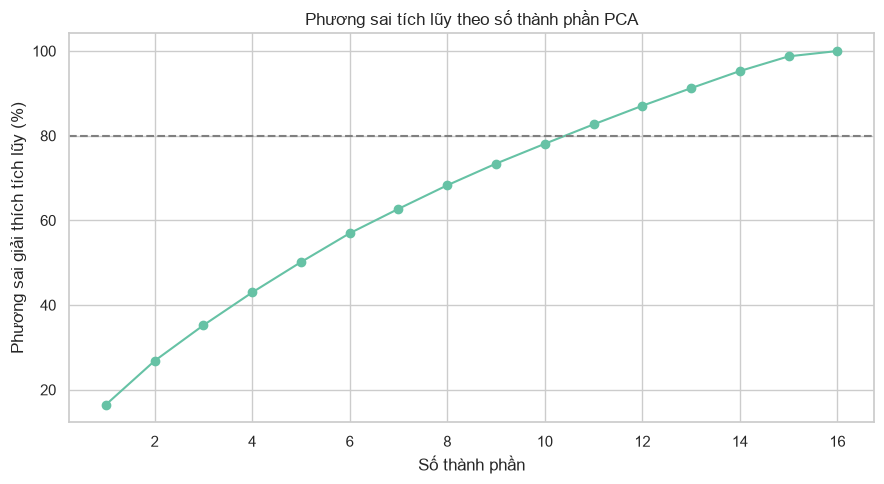

Nguồn: notebook 03_ml_readiness.ipynb, mục 3.6.

Để tránh data leakage, nhóm chỉ dùng thông tin có trước khi trò chơi phát hành (Bảng 6.1). Tags bị loại vì 97,8% trò chơi chưa có đánh giá bị thiếu Tags, còn trò chơi đã có đánh giá thì không thiếu; nếu dùng cột này, mô hình sẽ gián tiếp biết trò chơi đã có người chơi hay chưa.

Bảng 6.1. Lựa chọn đặc trưng cho mô hình

| Cột | Dùng? | Lý do |
|---|---|---|
| Price, Achievements, Genres, Categories, năm phát hành | Có | Nhà phát triển biết trước khi phát hành |
| Tags | Không | Do người chơi gắn |
| Positive, Negative, Recommendations | Không | Là kết quả sau khi trò chơi có người chơi |
| Estimated owners, Peak CCU | Không | Là thứ cần giải thích |
| Các cột thời gian chơi | Không | Chỉ có sau khi trò chơi có người chơi |
| Discount, DLC count | Không | Là trạng thái hiện tại, thay đổi sau khi phát hành |
| Metacritic score | Không | Chỉ có sau phát hành và thiếu ở phần lớn trò chơi |

Nguồn: notebook 03_ml_readiness.ipynb, mục 3.7.

Dữ liệu được chia 80% train (80.020 trò chơi) và 20% test (20.005 trò chơi), giữ nguyên tỷ lệ nhãn ở hai tập. Việc chuẩn hóa nằm trong pipeline nên chỉ học từ tập train.

## 6.2. Hồi quy tuyến tính

Nhóm xây dựng ba mô hình hồi quy để xem từng yếu tố liên hệ với kết quả như thế nào khi giữ các yếu tố khác không đổi. Mô hình A có mục tiêu là log1p(Total reviews), dùng cho RQ1, RQ4 và RQ5. Mô hình B có mục tiêu là Positive ratio, dùng cho RQ2, RQ4 và RQ5. Mô hình C có mục tiêu là log1p(Median playtime forever), dùng cho RQ3. Các mô hình được ước lượng bằng thư viện statsmodels [4], sai số chuẩn dùng HC3 vì phương sai sai số không đều giữa các trò chơi. Nhóm dùng Total reviews thay cho Peak CCU ở mô hình A vì Peak CCU có quá nhiều số 0.

Bảng 6.2. Hệ số của ba mô hình hồi quy tuyến tính

| Biến | A: Số đánh giá | B: Tỷ lệ tích cực | C: Thời gian chơi |
|---|---|---|---|
| log_price | 0,200 * | 1,418 * | 0,345 * |
| is_free | 0,850 * | 3,469 * | 0,117 * |
| has_achievements | 0,787 * | 3,468 * | 0,349 * |
| Năm phát hành | −0,335 * | 1,012 * | −0,006 * |
| Indie | −0,166 * | 0,320 | −0,218 * |
| Casual | −0,445 * | 1,203 * | −0,109 * |
| Action | −0,060 * | −2,898 * | −0,200 * |
| Adventure | 0,311 * | −1,563 * | 0,079 * |
| Simulation | 0,476 * | −5,139 * | 0,105 * |
| Strategy | 0,128 * | −2,127 * | 0,209 * |
| RPG | 0,197 * | −1,691 * | 0,291 * |
| Massively Multiplayer | 0,443 * | −6,877 * | 0,252 * |
| Multi-player | 0,030 | −0,177 | −0,031 |
| Co-op | 0,564 * | −0,627 | 0,128 * |
| Online PvP | 0,689 * | −0,639 | 0,121 * |
| Steam Cloud | 0,842 * | 4,341 * | 0,325 * |
| Full controller support | 0,499 * | 3,579 * | −0,027 |
| R2 trên tập test | 0,365 | 0,134 | 0,138 |

Ghi chú: dấu * nghĩa là p < 0,05; bảng lược bỏ Single-player, Sports, Racing. Nguồn: notebook 04_modeling.ipynb.

Mô hình B có mục tiêu là điểm phần trăm, nên hệ số 3,468 của has_achievements nghĩa là trò chơi có Achievements có tỷ lệ tích cực cao hơn khoảng 3,5 điểm khi các yếu tố khác giữ nguyên. Mô hình A và C có mục tiêu ở thang log, nên lấy e mũ hệ số: hệ số 0,787 nghĩa là số đánh giá gấp khoảng 2,2 lần. Hình 6.2 thể hiện các hệ số của mô hình B cùng khoảng tin cậy 95%.

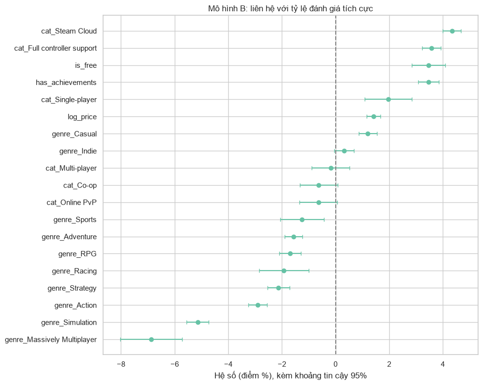

Nguồn: notebook 04_modeling.ipynb.

Kết quả chính theo từng câu hỏi như sau:

- RQ1: Steam Cloud (gấp khoảng 2,3 lần) và Achievements (gấp khoảng 2,2 lần) đi kèm nhiều đánh giá hơn. Simulation và Massively Multiplayer cao nhất trong các thể loại, Casual thấp nhất.
- RQ2: Massively Multiplayer (−6,9 điểm) và Simulation (−5,1 điểm) thấp nhất. Steam Cloud (+4,3), hỗ trợ tay cầm (+3,6) và Achievements (+3,5) đi kèm đánh giá cao hơn. Multi-player và Online PvP không còn ý nghĩa thống kê.
- RQ3: Achievements, Steam Cloud (đều gấp khoảng 1,4 lần) và RPG (gấp khoảng 1,3 lần) đi kèm thời gian chơi dài hơn.
- RQ4: mỗi năm phát hành mới hơn, số đánh giá giảm khoảng 28%, còn tỷ lệ tích cực tăng khoảng 1 điểm.
- RQ5: giá cao hơn đi kèm nhiều đánh giá hơn và thời gian chơi dài hơn, nhưng hệ số với tỷ lệ tích cực nhỏ: giá từ 5 lên 15 USD tăng khoảng 1,4 điểm.

Biến is_free phải đọc cùng log_price, vì game miễn phí có log_price bằng 0. So với trò chơi 10 USD, game miễn phí có số đánh giá gấp khoảng 1,4 lần và tỷ lệ tích cực gần như bằng nhau. R2 của mô hình B và C chỉ khoảng 0,13, nghĩa là các yếu tố này giải thích được rất ít; phần lớn khác biệt nằm ở những thứ không có trong dữ liệu, như chất lượng thật của trò chơi.

## 6.3. Đánh giá mô hình hồi quy

Với mỗi mục tiêu, nhóm so sánh ba mô hình trên tập test: baseline luôn đoán trung bình, hồi quy tuyến tính và Random Forest, xây dựng bằng thư viện scikit-learn [5] (Bảng 6.3).

Bảng 6.3. Kết quả các mô hình hồi quy

| Mục tiêu | Mô hình | R2 train | R2 test | MAE test |
|---|---|---|---|---|
| A: Số đánh giá | Baseline | 0,000 | 0,000 | 1,926 |
| A: Số đánh giá | Hồi quy tuyến tính | 0,357 | 0,365 | 1,511 |
| A: Số đánh giá | Random Forest | 0,469 | 0,432 | 1,406 |
| B: Tỷ lệ tích cực | Baseline | 0,000 | 0,000 | 14,229 |
| B: Tỷ lệ tích cực | Hồi quy tuyến tính | 0,132 | 0,134 | 13,046 |
| B: Tỷ lệ tích cực | Random Forest | 0,257 | 0,192 | 12,560 |
| C: Thời gian chơi | Baseline | 0,000 | 0,000 | 1,101 |
| C: Thời gian chơi | Hồi quy tuyến tính | 0,122 | 0,138 | 1,023 |
| C: Thời gian chơi | Random Forest | 0,289 | 0,166 | 0,992 |

Ghi chú: MAE của A và C tính trên thang log, của B tính bằng điểm phần trăm. Nguồn: notebook 05_model_evaluation.ipynb, mục 5.2.

Các mô hình đều tốt hơn baseline trên tập test, nên đạt tiêu chí đã đặt ra. Random Forest tốt nhất ở cả ba mục tiêu nhưng có R2 train cao hơn test khá nhiều ở mô hình C (0,289 và 0,166), đây là dấu hiệu overfitting. Với tỷ lệ tích cực, MAE chỉ giảm từ 14,2 xuống 12,6 điểm, nghĩa là dự đoán đánh giá của một trò chơi từ các đặc điểm này chưa chính xác.

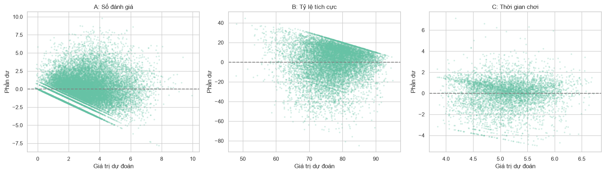

Nguồn: notebook 05_model_evaluation.ipynb, mục 5.3.

Hình 6.3 cho thấy phần dư của mô hình B có một đường chéo ở phía trên vì tỷ lệ tích cực bị chặn ở 100%, còn mô hình A có các đường chéo ở phía dưới vì nhiều trò chơi có rất ít đánh giá. Đây là giới hạn của hồi quy tuyến tính với các biến này, nên các hệ số ở Bảng 6.2 nên xem là mức chênh lệch gần đúng.

## 6.4. Mô hình phân loại

Bài toán phân loại dự đoán trò chơi có Peak CCU > 0 hay không, phục vụ RQ1. Tỷ lệ nhãn dương là 19,4% nên nhóm dùng class_weight="balanced". Nhóm so sánh baseline luôn đoán nhãn 0, Logistic Regression và Random Forest (Bảng 6.4).

Bảng 6.4. Kết quả các mô hình phân loại trên tập test

| Mô hình | Accuracy | Precision | Recall | F1 | ROC-AUC |
|---|---|---|---|---|---|
| Baseline | 0,806 | 0,000 | 0,000 | 0,000 | 0,500 |
| Logistic Regression | 0,719 | 0,379 | 0,698 | 0,491 | 0,779 |
| Random Forest | 0,751 | 0,414 | 0,689 | 0,518 | 0,805 |

Nguồn: notebook 05_model_evaluation.ipynb, mục 5.4.

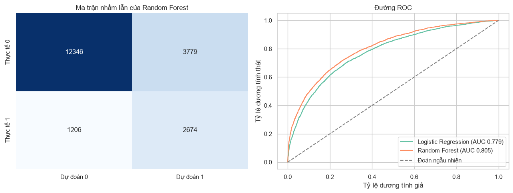

Nguồn: notebook 05_model_evaluation.ipynb, mục 5.4.

Baseline có accuracy cao nhất dù không phát hiện được trò chơi nào có Peak CCU > 0, đây là lý do không dùng accuracy một mình. Random Forest tốt nhất ở F1 và ROC-AUC. Mô hình phát hiện được 2.674 trong 3.880 trò chơi có Peak CCU > 0, nhưng cũng báo nhầm 3.779 trò chơi (Hình 6.4). Kiểm định chéo 5 phần cho F1 trung bình 0,521 với Random Forest và 0,491 với Logistic Regression, độ lệch chuẩn rất nhỏ, nên kết quả ổn định.

Thay đổi ngưỡng phân loại sẽ đổi giữa precision và recall. Ngưỡng 0,6 cho F1 cao nhất (0,524). Ngưỡng 0,3 có recall 0,904 nhưng precision chỉ 0,281, còn ngưỡng 0,8 có precision 0,774 nhưng recall còn 0,219.

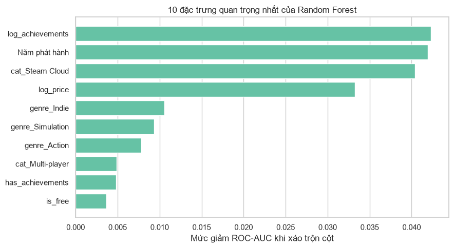

Nguồn: notebook 05_model_evaluation.ipynb, mục 5.7.

Bốn đặc trưng quan trọng nhất là số Achievements, năm phát hành, Steam Cloud và giá (Hình 6.5). Độ quan trọng cho biết mô hình dựa vào cột nào để dự đoán, không có nghĩa thêm Steam Cloud sẽ làm trò chơi đông người chơi hơn. Mô hình chỉ dùng thông tin có trước khi phát hành, nên không biết chất lượng thật hay ngân sách quảng bá. Vì vậy các mô hình hỗ trợ tốt cho việc trả lời các câu hỏi nghiên cứu, nhưng chưa đủ tốt để dự đoán cho từng trò chơi.

# CHƯƠNG 7. BIG DATA, ĐẠO ĐỨC VÀ THIÊN LỆCH

## 7.1. Dữ liệu của dự án theo 5V

Bảng 7.1. Dữ liệu của dự án theo 5V

| V | Ý nghĩa | Trong dự án |
|---|---|---|
| Volume | Khối lượng | 125.855 trò chơi, tệp gốc khoảng 400 MB, chạy được trên một máy tính cá nhân |
| Velocity | Tốc độ | Một lần tải về từ Kaggle, không phải dữ liệu cập nhật liên tục |
| Variety | Đa dạng | Có số, ngày tháng, khoảng ước tính và văn bản nhiều nhãn |
| Veracity | Độ tin cậy | Owners chỉ là khoảng ước tính, nhiều dữ liệu thiếu ở các năm gần đây |
| Value | Giá trị | Trả lời 5 câu hỏi nghiên cứu ở cấp độ trò chơi |

Nguồn: nhóm tổng hợp.

Dữ liệu này chưa phải big data vì một máy tính cá nhân xử lý được. Thách thức chính nằm ở Veracity, như đã thấy ở mục 3.2.3.

## 7.2. Các kỹ thuật khi dữ liệu lớn hơn

Nhóm thử ba kỹ thuật cơ bản. Đổi kiểu dữ liệu giảm bộ nhớ từ 75,2 MB xuống 61,1 MB, và bỏ thêm 4 cột văn bản còn 14,4 MB, cho thấy chỉ đọc những cột cần thiết là cách hiệu quả nhất. Đọc tệp theo từng phần với chunksize cho cùng kết quả với đọc một lần, phù hợp với các phép tính cộng dồn được. Lấy mẫu ngẫu nhiên 10% cho tỷ lệ Peak CCU > 0 là 19,50%, gần với 19,40% trên toàn bộ, còn mẫu 1% đã lệch 0,8 điểm.

## 7.3. Thiên lệch trong dữ liệu

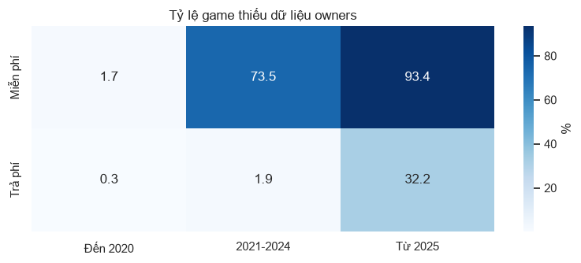

Nguồn: notebook 07_big_data_ethics_bias.ipynb, mục 7.5.

Thiên lệch quan trọng nhất là thiếu dữ liệu owners không ngẫu nhiên (Hình 7.1): từ 2021 đến 2024 có 73,5% game miễn phí bị thiếu, so với 1,9% game trả phí. Đây là thiên lệch đã làm sai con số về game miễn phí trong báo cáo giữa kỳ.

Độ phủ dữ liệu cũng nghiêng về trò chơi lớn (Bảng 7.2). Điểm Metacritic có ở 53,6% trò chơi trên 1 triệu người sở hữu nhưng chỉ 0,8% trò chơi dưới 20 nghìn. RQ2 và RQ3 vì vậy nghiêng về trò chơi đã có người chơi.

Bảng 7.2. Độ phủ dữ liệu theo quy mô trò chơi

| Quy mô (người sở hữu) | Số trò chơi | Có Metacritic (%) | Đủ 10 đánh giá (%) | Có thời gian chơi (%) |
|---|---|---|---|---|
| Dưới 20 nghìn | 74.604 | 0,8 | 45,4 | 12,7 |
| 20-200 nghìn | 20.083 | 8,2 | 85,0 | 56,7 |
| 200 nghìn-1 triệu | 3.991 | 31,3 | 98,0 | 92,7 |
| Trên 1 triệu | 1.347 | 53,6 | 99,6 | 98,7 |

Nguồn: notebook 07_big_data_ethics_bias.ipynb, mục 7.5.

Một số thiên lệch khác không đo được bằng dữ liệu này. Người viết đánh giá là những người tự nguyện, thường là người rất thích hoặc rất ghét trò chơi. Trò chơi đã bị gỡ khỏi Steam không có trong dữ liệu, nên các trò chơi cũ còn lại thường tốt hơn mức trung bình. Peak CCU chỉ đo trong một ngày nên có thể phụ thuộc vào ngày ghi nhận. Dữ liệu chỉ có Steam, không đại diện cho console hay điện thoại.

## 7.4. Thiên lệch của mô hình

Bảng 7.3. Kết quả của Random Forest theo nhóm trò chơi trên tập test

| Nhóm | Số trò chơi | Tỷ lệ thực tế (%) | Tỷ lệ dự đoán (%) | Precision | Recall |
|---|---|---|---|---|---|
| Miễn phí | 1.954 | 22,3 | 34,9 | 0,416 | 0,653 |
| Trả phí | 18.051 | 19,1 | 32,0 | 0,414 | 0,694 |
| Có Indie | 14.359 | 16,5 | 27,9 | 0,365 | 0,615 |
| Không Indie | 5.646 | 26,7 | 43,4 | 0,496 | 0,806 |
| Trước 2018 | 3.239 | 30,0 | 57,5 | 0,442 | 0,846 |
| 2018-2022 | 8.550 | 17,0 | 25,5 | 0,420 | 0,631 |
| Từ 2023 | 8.216 | 17,7 | 29,3 | 0,388 | 0,643 |

Nguồn: notebook 07_big_data_ethics_bias.ipynb, mục 7.6.

Mô hình hoạt động không đều giữa các nhóm. Recall ở trò chơi không có nhãn Indie là 0,806, ở trò chơi Indie là 0,615. Trò chơi phát hành trước 2018 có recall 0,846, trong khi các trò chơi mới hơn khoảng 0,63-0,64. Nếu dùng mô hình này để chọn trò chơi đáng chú ý, trò chơi Indie và trò chơi mới sẽ dễ bị bỏ sót hơn. Mô hình cũng dự đoán tỷ lệ dương cao hơn thực tế ở mọi nhóm, đây là hệ quả của class_weight="balanced".

## 7.5. Đạo đức khi sử dụng dữ liệu

- Quyền riêng tư: mỗi dòng là một trò chơi, không có thông tin của người chơi. Cột Support email đã bị bỏ ở bước rút gọn. Rủi ro về dữ liệu cá nhân thấp.
- Nguồn dữ liệu: nhóm cần đọc giấy phép trên trang bộ dữ liệu trước khi chia sẻ lại, vì kho mã nguồn đang chứa tệp games_reduced.csv.
- Minh bạch: mọi bước sửa dữ liệu được ghi vào nhật ký làm sạch. Khi phát hiện giả định về owners "0 - 0" là sai, nhóm nêu rõ và sửa kết luận ở mục 1.6.
- Diễn giải: mọi kết quả chỉ là mối liên hệ. Nói rằng trò chơi nên tăng giá hoặc thêm Achievements để thành công là vượt quá những gì dữ liệu cho phép.
- Tác động: nếu mô hình được dùng để quyết định đầu tư hay gợi ý trò chơi, nhà phát triển nhỏ và trò chơi mới có thể bị thiệt. Mô hình của nhóm không nên dùng cho mục đích này.

# CHƯƠNG 8. KẾT LUẬN

## 8.1. Trả lời các câu hỏi nghiên cứu

Ở bước chuẩn bị dữ liệu, nhóm phát hiện và khắc phục lỗi cấu trúc của tệp gốc, rút gọn dữ liệu từ 40 xuống 21 cột, và phát hiện vấn đề lớn nhất là các giá trị thiếu ẩn ở điểm số và số người sở hữu. Kết quả cho năm câu hỏi nghiên cứu như sau:

- RQ1: Các chỉ số phổ biến liên hệ cùng chiều với nhau; số người sở hữu và Peak CCU liên hệ ở mức trung bình (Spearman 0,47). Massively Multiplayer, RPG và Strategy có tỷ lệ trò chơi phổ biến cao nhất, còn Casual và Indie, dù có nhiều trò chơi nhất, có tỷ lệ thấp nhất.
- RQ2: Phần lớn trò chơi được đánh giá tốt (trung vị 81,2%). Đánh giá của người chơi và giới phê bình tương đồng ở mức khá (Spearman 0,58). Massively Multiplayer có tỷ lệ tích cực thấp hơn hẳn (66,7%). Steam Cloud, hỗ trợ tay cầm và Achievements đi kèm đánh giá cao hơn, kể cả khi đã tính đến giá, năm phát hành và thể loại.
- RQ3: RPG và Strategy có thời gian chơi cao nhất, trò chơi giá cao được chơi lâu hơn. Xu hướng theo thể loại ở hai tuần gần nhất chỉ giống một phần với toàn bộ lịch sử (tương quan thứ hạng 0,52), khác biệt rõ nhất là Massively Multiplayer.
- RQ4: Trò chơi phát hành sớm có tỷ lệ còn người chơi và số đánh giá cao hơn rõ rệt. Từ 2018 tỷ lệ có người chơi gần như không đổi. Tỷ lệ tích cực thấp nhất ở 2014-2017 rồi tăng lại, nhưng một phần xu hướng này do cách chọn trò chơi.
- RQ5: Trong các trò chơi trả phí, giá cao hơn đi kèm tỷ lệ có người chơi đồng thời cao hơn (19,9% đến 36,4%), nhưng không đi kèm tỷ lệ có nhiều người sở hữu cao hơn. Game miễn phí không thua game trả phí về độ phổ biến. Giá liên hệ rất yếu với đánh giá (Spearman 0,12).

Một phát hiện xuyên suốt là mức độ phổ biến và mức độ đánh giá là hai khía cạnh khác nhau của trò chơi: thể loại phổ biến nhất không phải là thể loại được đánh giá cao nhất, và giá liên hệ với mức độ phổ biến rõ hơn so với đánh giá.

Về mô hình, các mô hình đều tốt hơn baseline. Random Forest tốt nhất, với R2 test từ 0,166 đến 0,432 cho hồi quy và ROC-AUC 0,805 cho phân loại, nhưng khả năng dự đoán chỉ ở mức vừa phải.

## 8.2. Bài học rút ra

Bài học lớn nhất của dự án là phải kiểm tra lại các giả định về dữ liệu. Giả định về nhóm owners "0 - 0" có vẻ hợp lý ở giữa kỳ, nhưng chỉ được kiểm tra bằng những cột cùng bị thiếu. Khi đối chiếu với lượt đề xuất, giả định này không còn đứng vững, và một kết luận về game miễn phí đã thay đổi. Một số 0 trong dữ liệu có thể là thiếu dữ liệu, và thiếu dữ liệu không ngẫu nhiên có thể làm sai kết luận mà không gây ra lỗi nào khi chạy.

## 8.3. Hạn chế

- Các kết quả chỉ thể hiện mối liên hệ, không phải quan hệ nhân quả. Phân tích kiểu A/B không có chia ngẫu nhiên.
- Estimated owners chỉ là khoảng ước tính, Peak CCU chỉ đo trong một ngày, và khoảng 81% trò chơi có Peak CCU bằng 0.
- Dữ liệu owners bị thiếu ở 24.572 trò chơi, tập trung ở game miễn phí và game mới. So sánh theo giá vì vậy chỉ dùng trò chơi đến năm 2020, và kết luận về game miễn phí không áp dụng cho những năm gần đây.
- Một số trò chơi lớn ngoài nhóm "0 - 0" cũng có số liệu không hợp lý, ví dụ Portal 2, và nhóm chưa có cách tách hết các trường hợp này.
- User score gần như trống, điểm Metacritic chỉ có ở khoảng 4.000 trò chơi, chủ yếu là trò chơi lớn.
- Hai cột ngôn ngữ đã bị loại ở bước rút gọn; dự án hiện không đánh giá được ảnh hưởng của hỗ trợ ngôn ngữ hoặc lồng tiếng.
- Giá trong dữ liệu là giá hiện tại. Bộ dữ liệu không ghi thời điểm thu thập và định nghĩa Peak CCU được suy ra từ SteamSpy.
- Mô hình không có thông tin về chất lượng và ngân sách quảng bá, nên khả năng giải thích còn thấp.

## 8.4. Hướng phát triển

Nếu tiếp tục, nhóm sẽ ưu tiên các cột/dữ liệu ở Bảng 8.1.

Bảng 8.1. Cột và dữ liệu đang xem xét bổ sung

| Cột/dữ liệu đang xem xét | Câu hỏi liên quan | Lý do bổ sung | Tác động dự kiến và lưu ý |
|---|---|---|---|
| `Supported languages`, `Full audio languages` | RQ1–RQ3 mở rộng | Hai cột hiện đã bị bỏ; cho phép mô tả khả năng tiếp cận theo ngôn ngữ. | Kiểm tra thiếu dữ liệu và chuẩn hóa danh sách ngôn ngữ; không gộp “không hỗ trợ” với “không rõ”. |
| `Developers`, `Publishers` | RQ1, RQ2, RQ5 | Có thể phân tích khác biệt giữa nhà phát triển độc lập và nhà phát hành lớn; bổ sung biến đại diện quy mô nguồn lực. | Tên tổ chức có nhiều biến thể; cần chuẩn hóa và không suy luận ngân sách trực tiếp nếu thiếu dữ liệu tài chính. |
| Owners và Peak CCU theo ngày, kèm ngày thu thập | RQ1, RQ4, RQ5 | Khắc phục thiếu owners, đặc biệt ở game miễn phí/game mới, và hạn chế của Peak CCU một ngày. | Cho phép so sánh cùng cửa sổ thời gian sau phát hành; cần lưu lịch sử thay vì chỉ ghi giá trị mới nhất. |
| Giá và mức giảm giá theo thời điểm | RQ5 | Giá hiện tại không đại diện cho giá tại thời điểm mua. | Tách ảnh hưởng của giá niêm yết và khuyến mãi; cần dữ liệu lịch sử. |
| Ngày phát hành và phiên bản dữ liệu | Tất cả | Tái lập kết quả và đặt các game vào cohort có cùng thời gian quan sát. | Ghi timestamp và nguồn cho mỗi lần thu thập. |

Sau khi bổ sung dữ liệu, nhóm có thể dùng mô hình phù hợp hơn với biến có nhiều số 0 hoặc bị chặn.

# TÀI LIỆU THAM KHẢO

[1] FronkonGames, “Steam Games Dataset,” Kaggle. [Trực tuyến]. Địa chỉ: https://www.kaggle.com/datasets/fronkongames/steam-games-dataset. [Ngày truy cập: bổ sung].

[2] SteamSpy, “SteamSpy API.” [Trực tuyến]. Địa chỉ: https://steamspy.com/api.php. [Ngày truy cập: 05/11/2026].

[3] P. Virtanen et al., “SciPy 1.0: Fundamental Algorithms for Scientific Computing in Python,” Nature Methods, vol. 17, pp. 261–272, 2020.

[4] S. Seabold and J. Perktold, “Statsmodels: Econometric and Statistical Modeling with Python,” in Proc. 9th Python in Science Conference, 2010.

[5] F. Pedregosa et al., “Scikit-learn: Machine Learning in Python,” Journal of Machine Learning Research, vol. 12, pp. 2825–2830, 2011.

# PHỤ LỤC. ĐỐI CHIẾU NỘI DUNG MÔN HỌC

Bảng PL.1. Các nội dung môn học trong dự án

| Buổi | Nội dung | Vị trí trong dự án | Vị trí trong báo cáo |
|---|---|---|---|
| 1 | What is Data Science | Project charter | Chương 1 |
| 2 | Data Collection | Project charter, 00_reduce_raw | Chương 2 |
| 3 | Data quality and Processing | 01_data_quality | Chương 3 |
| 4 | Outliers, noise & consistency | 01_data_quality | Mục 3.2 |
| 5 | Transformation, reduction & integration | 00_reduce_raw, 03_ml_readiness | Mục 2.3, 6.1 |
| 6 | Probability & descriptive statistics | 02_eda, 06_statistical_inference | Mục 4.2, 5.1 |
| 7 | Data visualization | 02_eda, 02b_eda_rq3_rq4 | Chương 4 |
| 9 | Statistical inference & AB testing | 06_statistical_inference | Chương 5 |
| 10 | Regression analysis | 04_modeling, 05_model_evaluation | Mục 6.2, 6.3 |
| 11 | Classification & feature engineering | 03_ml_readiness, 04_modeling, 05_model_evaluation | Mục 6.1, 6.4 |
| 12 | Big data, ethics and bias | 07_big_data_ethics_bias | Chương 7 |

Nguồn: nhóm tổng hợp.
